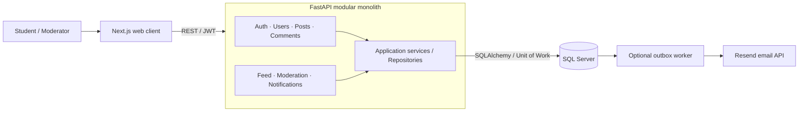

# UITConnect

A full-stack social networking platform for the UIT student community, built around modular backend services, personalized content discovery, and community moderation.

**Stack:** Next.js · React · TypeScript · FastAPI · SQLAlchemy · SQL Server · Alembic · Docker

**Status:** Active development (V2) · University team project

## Overview

UITConnect provides a shared space for students to publish posts, exchange ideas, discover relevant content, and interact with their community. The second iteration focuses on improving software architecture, integration reliability, and deployment workflows while extending the existing forum functionality.

## Key features

| Area | Functionality |
| --- | --- |
| Authentication | Registration, login, JWT access and refresh tokens, logout, optional Google OAuth |
| Content | Post creation, editing, deletion, tags, search, sorting and pagination |
| Social interactions | Likes, bookmarks, sharing, nested comments, follow/unfollow |
| Content discovery | Trending, similarity-based, collaborative and profile-based recommendations |
| Moderation | Reporting, approval/rejection workflows, account and tag management |
| Notifications | Persisted notifications for interactions and moderation events |

## System architecture



The modular monolith organizes business capabilities into feature modules rather than independently deployed microservices. Routers handle HTTP concerns, application services orchestrate use cases, and repositories encapsulate persistence.

## Engineering highlights

- **Transaction consistency:** Application Service, Repository and Unit of Work patterns keep related writes atomic. Notifications are persisted in the same transaction as their corresponding business actions.
- **Asynchronous email delivery:** The password-reset flow uses a durable transactional outbox and a separate worker with retries, lease-based claiming and provider idempotency keys. Delivery is at-least-once, not exactly-once.
- **Database evolution:** Alembic migrations are executed as a separate deployment step. The [baseline verification](backend/alembic/BASELINE_VERIFICATION.md) documents validation against a real SQL Server schema containing 16 application tables, 46 indexes and 31 foreign keys.
- **Deployment readiness:** Docker Compose, GitHub Actions, a shared API entrypoint, startup database checks and a liveness endpoint support consistent development and deployment workflows.
- **Security:** JWT authentication, permission and ownership checks, explicit CORS configuration and production secret validation.

## Technology stack

| Layer | Technologies |
| --- | --- |
| Frontend | Next.js, React, TypeScript, Tailwind CSS |
| Backend | Python, FastAPI, SQLAlchemy, Uvicorn |
| Database | Microsoft SQL Server, ODBC Driver 18, Alembic |
| Infrastructure | Docker, Docker Compose, GitHub Actions |
| Deployment targets | Vercel, Render, Azure SQL / external SQL Server |
| Email integration | Resend (optional configured outbox worker) |

## Getting started

### Docker Compose

Prerequisite: Docker Engine with Compose and sufficient resources for SQL Server. The default configuration is for local development only; configure your own secrets for shared environments.

```bash
git clone https://github.com/zaabinh/SE347-UITConnect.git
cd SE347-UITConnect
git checkout develop
docker compose up -d --build
```

| Service | Local URL |
| --- | --- |
| Web application | http://localhost:3000 |
| API documentation | http://localhost:8000/docs |
| API liveness | http://localhost:8000/health |

The Compose database initialization service prepares the local database before the backend starts. For native development, copy `backend/.env.example` and `frontend/.env.example` to the corresponding local environment files and configure the SQL Server connection and allowed origins.

```bash
# Backend (from backend/, with a Python virtual environment active)
pip install -e '.[dev]'
python -m scripts.setup_local_db --wait 90
python -m app

# Frontend (in another terminal, from frontend/)
npm ci
npm run dev
```

For the optional email worker, follow the migration and provider configuration in the [transaction runbook](docs/BACKEND_TRANSACTIONS.md).

## Testing and deployment

```bash
# Backend, from backend/
python -m pytest -q

# Frontend, from frontend/
npm ci
npm run build

# From repository root (validate Compose without exposing configuration)
docker compose config --quiet
```

CI configuration: [GitHub Actions](.github/workflows/ci.yml). Database changes follow the [migration workflow](.github/workflows/database-migrations.yml) and [Alembic runbook](backend/alembic/README.md). The Docker smoke test does not replace SQL Server integration testing. Deployment configuration is available in [render.yaml](render.yaml); a live production deployment is not claimed here.

## Repository layout

```text
backend/         FastAPI application, modules, migrations and tests
frontend/        Next.js web application
Database/        Database documentation
docs/            Technical documentation
.github/         CI and migration workflows
```

## Documentation

- [Backend transactions and transactional outbox](docs/BACKEND_TRANSACTIONS.md)
- [Database migration runbook](backend/alembic/README.md)
- [Database schema](Database/database.md)
- [API overview (partial; use Swagger for the current contract)](docs/API_ENDPOINTS.md)

## Current limitations

Email verification, real-time notifications and settings functionality are still under development. The password-reset outbox is implemented in code, but live email delivery requires provider configuration and a running worker. Further production integration and performance validation are required.

## Project context

Developed as a team project for SE347 at the University of Information Technology (VNU-HCM). The repository preserves the team's shared implementation and engineering documentation; individual contributions can be reviewed through the commit and pull request history.
