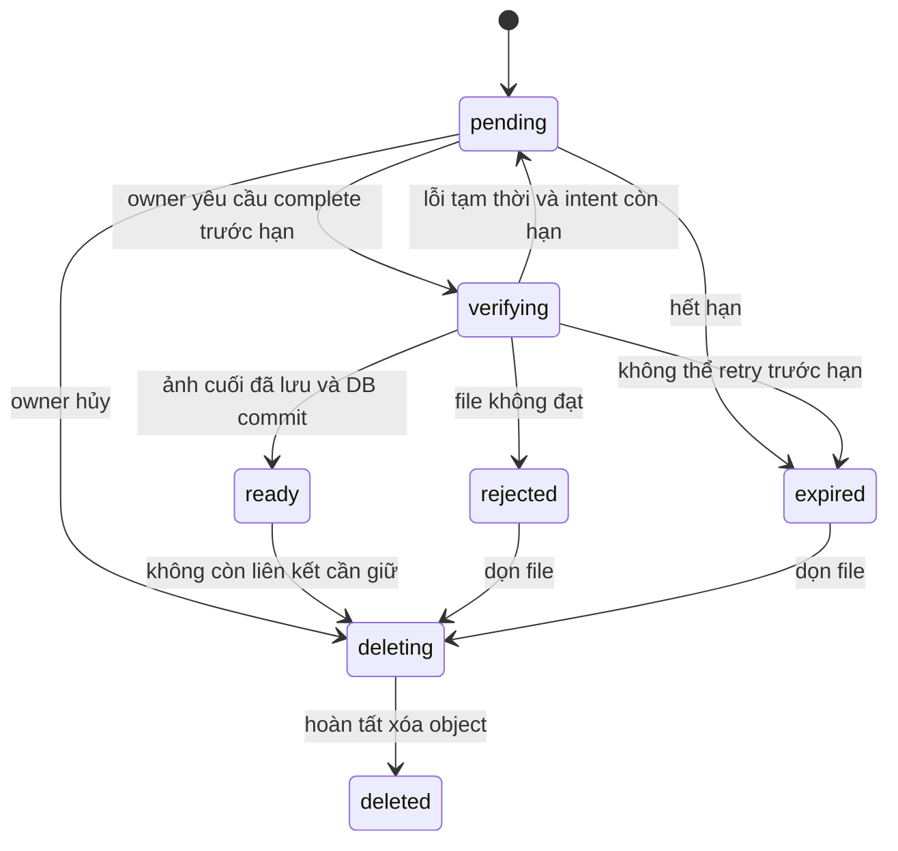

# Thiết kế upload ảnh an toàn với Cloudflare R2

Trạng thái: Bản nháp để Bình và người phụ trách API-01 review. Các endpoint, giới hạn và chính sách dưới đây là đề xuất thiết kế, chưa phải contract đã công bố.

- Issue: [MD-01 Media Storage và Secure Upload](https://github.com/zaabinh/SE347-UITConnect/issues/5).
- Implementation owner: Đông, `@QuangDong-2006`.
- Nhánh làm việc: `feature/cloudflare-r2-media-upload`, tạo từ `develop` tại commit `6b638b5`.
- Cloudflare và architecture reviewer: Bình, `@zaabinh`.
- Ngày: 20/11/2026. Mã nguồn đối chiếu: `6b638b5`.
- Cập nhật trạng thái ngày 21/11/2026: bản nháp bước A đã soạn, chờ review; adapter, migration và tích hợp frontend chưa triển khai.

UITConnect sẽ lưu ảnh lâu dài trên R2 và lưu thông tin quản lý ảnh trong SQL Server. Trình duyệt upload trực tiếp vào vùng tạm bằng URL có chữ ký. Backend kiểm tra file thực tế, tạo bản ảnh cuối cùng và chỉ cho phép gắn ảnh đã xác minh vào bài viết. Ảnh người dùng luôn nằm trong bucket private; quyền xem phụ thuộc tài khoản và bài viết.

## Cách đọc và các khái niệm

Đông có thể đọc từ hiện trạng đến lifecycle trước, sau đó đọc metadata và API. Bình tập trung vào bucket, quyền truy cập, xác minh và cấu hình. API-01 và Na review phần contract cùng cách tích hợp bài viết.

| Khái niệm | Ý nghĩa trong thiết kế |
| --- | --- |
| Object storage | Dịch vụ lưu file, ở đây là Cloudflare R2 |
| Bucket | Kho chứa object với cấu hình truy cập riêng |
| Object key | Tên định danh file trong bucket, do backend sinh |
| Metadata | Bản ghi SQL chứa chủ sở hữu, trạng thái và thông tin kiểm tra file |
| Upload intent | Yêu cầu upload đã được backend cấp phép và ghi nhận |
| Presigned URL | URL có chữ ký cấp quyền tạm thời cho một thao tác trên một object |
| Storage Adapter | Lớp giao tiếp R2, tách khỏi nghiệp vụ kiểm tra quyền và quản lý media |
| Idempotent | Gọi lại thao tác không tạo thêm ảnh hoặc liên kết ngoài ý muốn |

## Hiện trạng và phạm vi

### Những chỗ cần thay đổi

| Vị trí | Hiện trạng | Thay đổi cần thiết |
| --- | --- | --- |
| [PostEditor.tsx](../frontend/components/post/PostEditor.tsx) | Dùng `FileReader.readAsDataURL` khi chọn ảnh | Giữ preview trên máy, thực hiện upload R2 trước khi gửi bài |
| [Trang tạo bài](../frontend/app/create/page.tsx) và [trang sửa bài](../frontend/app/edit/%5Bid%5D/page.tsx) | Truyền ảnh qua `cover_image` | Gửi định danh media đã được xác minh |
| [Upload router](../backend/routers/upload.py) | `POST /upload/image` ghi file local, chưa kiểm tra đăng nhập | Thay bằng Media API có xác thực và kiểm tra ownership |
| [Backend entrypoint](../backend/main.py) | Mount thư mục local thành `/uploads` | Loại bỏ phụ thuộc này cho media persistent trên production sau khi chuyển dữ liệu |
| [Post schema](../backend/schemas/post_schema.py), [post router](../backend/routers/post.py) và [Post model](../backend/models/post.py) | Nhận/lưu `cover_image` dạng chuỗi | Thêm liên kết media và validate ở backend |
| [AvatarPicker](../frontend/components/ui/AvatarPicker.tsx) và [profile API](../backend/routers/user.py) | Avatar cũng có thể dùng Data URL; profile nhận `avatar_url` | Tích hợp lại Media API ở giai đoạn sau |
| [Database upgrade script](../backend/scripts/upgrade_db.py) | Có cơ chế chạy SQL upgrade thủ công | Thống nhất Alembic baseline và migration với người phụ trách database |

Luồng hiện tại: người dùng chọn ảnh → frontend tạo Data URL → gửi trong JSON tạo bài → backend lưu chuỗi vào `posts.cover_image`. API upload local là một luồng khác, chưa có bước cấp phép và xác minh object như yêu cầu MD-01.

Phạm vi triển khai đầu tiên là ảnh bìa bài viết. Thiết kế để mở rộng cho avatar sau khi luồng cốt lõi ổn định. Logo UITConnect là public asset do Bình phối hợp quản lý. Video, tài liệu, chỉnh sửa ảnh nâng cao và dịch vụ quét nội dung tự động nằm ngoài phạm vi này.

### Phân công

| Thành viên | Trách nhiệm |
| --- | --- |
| Đông | Metadata, Media API, adapter, verification, ownership, migration phối hợp DB, tests và tài liệu |
| Bình | Bucket, credentials, CORS, domain, review security và cấu hình staging/production |
| Na | Phối hợp Đông tích hợp UI chọn ảnh, tiến trình upload, lỗi và thay Data URL persistent |
| API-01 | Thống nhất route, DTO, mã lỗi và thay đổi contract bài viết |
| Người phụ trách database | Review FK, index, Alembic baseline, upgrade và chuyển dữ liệu cũ |

## Chính sách đề xuất

| Nội dung | Giá trị hoặc quy tắc |
| --- | --- |
| Purpose đầu tiên | `post_cover`; chưa mở upload avatar trong lần tích hợp đầu |
| Định dạng | JPEG và PNG một frame; extension `.jpg`, `.jpeg`, `.png` |
| MIME | `image/jpeg`, `image/png`; frontend chuẩn hóa JPEG thành `image/jpeg` |
| Dung lượng đầu vào | Từ 1 đến 5 MiB, tối đa `5242880` byte |
| Giới hạn ảnh giải mã | Tối đa 4096 pixel mỗi chiều và 16000000 pixel tổng cộng |
| Ảnh cuối cùng | JPEG hoặc PNG được backend ghi lại từ dữ liệu đã giải mã; cũng không vượt 5 MiB |
| Tên file gốc | Tối đa 255 ký tự, cấm ký tự điều khiển, separator đường dẫn và tên nhiều phần mở rộng như `photo.exe.png` |
| TTL URL upload | 300 giây; hạn intent dùng cùng mốc thời gian |
| TTL URL xem ảnh | 60 giây; frontend xin URL mới khi cần |
| Giới hạn cấp intent | 10 intent mỗi tài khoản mỗi 10 phút; tối đa 3 intent `pending` hoặc `verifying` đồng thời |
| Ảnh `ready` chưa gắn vào bài | Giữ tối đa 24 giờ tính từ `verified_at` |
| Bài bị soft delete | Ngừng cấp URL mới ngay; giữ liên kết và ảnh 7 ngày trước khi dọn |
| Xử lý file tạm | Job mỗi 10 phút, chỉ dọn sau hạn URL upload cộng 60 giây và không có verifier đang sở hữu lease |

Các con số cần Bình/API-01 xác nhận và đo lại trên staging. Kiểm tra dung lượng ở client giúp trải nghiệm; backend vẫn kiểm tra dữ liệu thực tế. Giới hạn 5 MiB là điều kiện để hệ thống chấp nhận media, không phải cam kết rằng một URL PUT luôn ngăn R2 nhận object lớn hơn. Giới hạn cấp intent và cảnh báo dung lượng giúp giảm lạm dụng; Bình cần chấp nhận giới hạn này hoặc chọn cơ chế ingress có thể chặn dung lượng trước khi lưu.

## Bucket và object key

Đề xuất tách ba bucket theo môi trường. Tên dưới đây là ví dụ, Bình cung cấp tên thực tế.

| Bucket ví dụ | Truy cập | Nội dung |
| --- | --- | --- |
| `uitconnect-staging-uploads` | Private | File chưa tin cậy do browser upload |
| `uitconnect-staging-media` | Private | Ảnh đã xác minh, chỉ backend ghi |
| `uitconnect-staging-assets` | Public qua HTTPS domain đã thống nhất | Logo và tài nguyên công khai do nhóm quản lý |

Production dùng bucket riêng, không chia sẻ credentials hoặc dữ liệu với staging. Prefix `pending/` trong một bucket public không tự bảo vệ nội dung. Cloudflare phân biệt bucket private với các cách bật public access; cấu hình public asset phải tách khỏi ảnh người dùng. [Nguồn Cloudflare về public bucket](https://developers.cloudflare.com/r2/buckets/public-buckets/).

Quy ước key:

```text
uploads bucket: pending/{owner_uuid}/{media_uuid}
media bucket:   post-covers/{owner_uuid}/{media_uuid}/{attempt_uuid}.jpg
assets bucket:  branding/uitconnect-logo-v1.png
```

Backend sinh UUID và chọn extension cuối từ định dạng đã xác minh. Client không được chọn bucket, key, owner hoặc URL đích. Mỗi lần xác minh tạo key cuối riêng theo `attempt_uuid`; không ghi đè bản cuối của lần trước.

Logo được kiểm tra thủ công, upload bằng quyền quản trị riêng và bàn giao URL HTTPS ổn định để cấu hình `MAIL_LOGO_URL`. Runtime Media API không có quyền ghi bucket public assets.

## Lifecycle và xác minh

### Luồng thành công


URL có chữ ký cấp một thao tác trên một object và có thể dùng lại đến khi hết hạn. Do đó, hoàn tất upload không đồng nghĩa URL PUT đã bị thu hồi. [Nguồn Cloudflare về presigned URL](https://developers.cloudflare.com/r2/api/s3/presigned-urls/).

Browser chỉ có URL ghi bucket uploads. Backend đọc một snapshot có giới hạn vào bộ nhớ, xác minh và tạo ảnh cuối từ chính snapshot đó. Không thực hiện `HEAD` rồi copy mù object tạm, vì object có thể thay đổi giữa hai thao tác. File tạm bị ghi lại sau đó không thể thay đổi ảnh cuối đã được chấp nhận.

Đây là lý do bảo mật để backend đọc và ghi lại ảnh ở bước verification. Dữ liệu upload ban đầu vẫn đi trực tiếp từ browser đến R2. Không dùng local filesystem làm nơi lưu persistent hoặc fallback; dữ liệu kiểm tra chỉ tồn tại trong bộ nhớ có giới hạn.

### Trạng thái



`ready` nghĩa là ảnh hợp lệ và có thể gắn vào bài; quyền đọc được tính riêng. Liên kết với bài không phải một trạng thái media mới. Khi xóa lúc URL PUT còn hiệu lực, media giữ `deleting` cho đến khi qua hạn URL và buffer; chỉ chuyển `deleted` sau lần dọn cuối.

### Các bước xác minh

1. Xác thực user hiện tại, kiểm tra owner, purpose, trạng thái và hạn bằng đồng hồ backend theo UTC. Tái sử dụng điều kiện user active, đã hoàn tất profile trong [auth dependency](../backend/dependencies/auth.py). Tên dependency có chữ `verified` nhưng code hiện không yêu cầu xác minh email.
2. Chuyển `pending` sang `verifying` bằng cập nhật có điều kiện; cấp `verification_token` và lease 120 giây. Chỉ một verifier thắng. Không giữ transaction SQL mở trong lúc gọi R2 hoặc xử lý ảnh.
3. Dùng `HEAD` để phát hiện object thiếu/quá lớn; đọc một lần với giới hạn tối đa `MAX_BYTES + 1`. Đếm byte thực nhận và so sánh với `declared_size_bytes`, không chỉ tin metadata R2.
4. Kiểm tra extension đã chuẩn hóa, MIME đã ký và nội dung thực. Đọc signature chỉ là bước đầu; phải giải mã ảnh đầy đủ, giới hạn frame, chiều và tổng pixel. Cấm SVG, GIF, WebP, file hỏng và ảnh nhiều frame trong scope đầu.
5. Chỉnh orientation trước khi bỏ EXIF, ghi lại JPEG/PNG từ pixel đã giải mã, loại bỏ metadata ngoài chính sách và kiểm tra lại kích thước output. Decoder có giới hạn thời gian/bộ nhớ và concurrency; không chạy tác vụ đồng bộ nặng trực tiếp trên event loop.
6. Tính SHA-256 của ảnh cuối, lưu vào media bucket bằng key của attempt. Cập nhật metadata và `ready` chỉ khi `verification_token` vẫn khớp, user vẫn đủ điều kiện và trạng thái chưa bị thu hồi.
7. Commit thành công mới trả `ready`. Nếu mất quyền cập nhật hoặc commit thất bại, ảnh vừa ghi là orphan private cần dọn; không trả thành công. Job thu hồi lease hết hạn bằng cập nhật có điều kiện; worker cũ không thể commit bằng token đã thay.

Kiểm tra nhiều lớp và không tin `Content-Type` phù hợp với [OWASP File Upload Cheat Sheet](https://cheatsheetseries.owasp.org/cheatsheets/File_Upload_Cheat_Sheet.html). Đề xuất dùng Pillow cho decoder, bật lỗi cho cảnh báo decompression bomb và đặt ngưỡng pixel của ứng dụng; [tài liệu Pillow](https://pillow.readthedocs.io/en/stable/reference/Image.html#PIL.Image.open) mô tả cơ chế cảnh báo này. Tính khả thi của ngưỡng timeout và bộ nhớ cần smoke test trên cấu hình Render thực tế.

## Metadata và liên kết database

Đề xuất bảng `media`, dùng UUID tương thích kiểu `UNIQUEIDENTIFIER` của users. Thời gian dùng UTC; API trả ISO 8601 có `Z`.

| Trường | Kiểu dự kiến | Ý nghĩa |
| --- | --- | --- |
| `id` | UNIQUEIDENTIFIER, PK | Định danh gửi cho frontend |
| `owner_id` | UNIQUEIDENTIFIER, FK users | Chủ upload; lấy từ user đã xác thực |
| `purpose` | VARCHAR(30) | `post_cover`, dự trù `avatar` |
| `status` | VARCHAR(20) | Các trạng thái lifecycle ở trên |
| `upload_key` | VARCHAR(512), unique | Key private tạm, backend sinh |
| `final_key` | VARCHAR(512), nullable, unique khi có | Key cuối của attempt được chấp nhận |
| `original_filename` | NVARCHAR(255) | Tên hiển thị đã kiểm tra |
| `declared_content_type` | VARCHAR(100) | MIME client khai báo đã được chuẩn hóa |
| `declared_size_bytes` | BIGINT | Dung lượng client khai báo |
| `verified_content_type` | VARCHAR(100), nullable | Định dạng nội dung đã xác minh |
| `verified_input_size_bytes` | BIGINT, nullable | Dung lượng đầu vào thực tế |
| `stored_size_bytes` | BIGINT, nullable | Dung lượng ảnh cuối sau ghi lại |
| `width`, `height` | INT, nullable | Kích thước ảnh cuối |
| `sha256` | CHAR(64), nullable | Hash ảnh cuối; không coi ETag là hash nội dung |
| `failure_code` | VARCHAR(50), nullable | Mã lỗi đã làm sạch, không lưu exception R2 |
| `created_at`, `updated_at` | DATETIME2 | Thời gian tạo và cập nhật |
| `upload_expires_at` | DATETIME2 | Hạn cấp quyền upload và bắt đầu verification |
| `verification_token` | UNIQUEIDENTIFIER, nullable | Quyền commit riêng của một attempt |
| `verification_lease_until` | DATETIME2, nullable | Hạn xử lý attempt; không gia hạn URL PUT |
| `verified_at`, `deleted_at` | DATETIME2, nullable | Mốc xác minh/xóa |
| `cleanup_after` | DATETIME2, nullable | Lịch dọn và retry khi xóa thất bại |

Tên bucket lấy từ cấu hình riêng của môi trường, không nhận từ request. Không lưu secret hoặc presigned URL trong bảng. Cần index cho owner/trạng thái, status/hạn upload và cleanup; check constraint cho status, purpose và dung lượng dương.

Thêm `posts.cover_media_id` nullable, FK đến `media.id`. Mỗi media ảnh bìa gắn với tối đa một bài gốc; dùng ràng buộc unique cho giá trị khác NULL phù hợp SQL Server. Share truy xuất ảnh từ bài gốc qua `original_post_id`, không sao chép URL hoặc tạo liên kết cover mới. Việc thay đổi này phải cập nhật cả share route hiện đang copy `cover_image`.

Thao tác gắn/thay ảnh kiểm tra owner, `purpose=post_cover`, `status=ready` và chưa gắn vào bài gốc khác trong cùng transaction. Đọc/khóa bản ghi media theo thứ tự cố định để thao tác attach, delete và job cleanup không cùng thắng. Khi thay ảnh, chỉ bỏ liên kết ảnh cũ sau khi ảnh mới và bài được lưu thành công.

## API đề xuất

Các route ứng dụng dùng JWT như backend hiện tại. Cấu trúc lỗi và tên DTO cần API-01 review trước khi công bố. UUID trong ví dụ chỉ là dữ liệu minh họa.

### Tạo upload intent

`POST /api/media/upload-intents` → `201 Created`.

```json
{
  "purpose": "post_cover",
  "filename": "anh-uit.png",
  "content_type": "image/png",
  "size_bytes": 123456
}
```

```json
{
  "media_id": "99c4c396-8724-4dbb-9aa8-b909b80e81d7",
  "status": "pending",
  "upload": {
    "method": "PUT",
    "url": "https://example.invalid/presigned-upload-placeholder",
    "headers": { "Content-Type": "image/png" },
    "expires_at": "2026-11-20T03:05:00Z",
    "max_size_bytes": 5242880
  }
}
```

Response header `Cache-Control: no-store`. Owner lấy từ JWT/DB; từ chối trường ngoài schema, bao gồm owner, bucket và key do client tự thêm. Chỉ ký thao tác PUT cho đúng uploads bucket, key của intent và `Content-Type` đã chuẩn hóa. Ghi metadata thành công trước khi trả capability upload. Không gia hạn cùng intent; khi hết hạn, client xin intent mới. Timeout tạo intent có thể để lại bản ghi không dùng được; quota và cleanup xử lý bản ghi đó.

### Upload trực tiếp

Browser `PUT` raw `File` đến `upload.url`, với đúng `upload.headers`. Không dùng `FormData` và không gửi JWT UITConnect cho R2. Dùng `fetch` hoặc HTTP client riêng; [Axios instance hiện tại](../frontend/lib/axios.ts) có JSON header và auth interceptor nên không tái sử dụng cho request R2.

Response `2xx` từ R2 chỉ xác nhận object đã được gửi, chưa xác nhận media được sử dụng. Nếu R2 timeout mà không rõ kết quả, gọi complete để kiểm tra object trước khi upload lại; UI không tự đánh dấu `ready`.

### Xác minh hoàn tất

`POST /api/media/{media_id}/complete`, body rỗng → `200 OK` khi sẵn sàng.

```json
{
  "media_id": "99c4c396-8724-4dbb-9aa8-b909b80e81d7",
  "status": "ready",
  "content_type": "image/png",
  "size_bytes": 120000,
  "width": 1200,
  "height": 800
}
```

Nếu đang có verifier khác: `202 Accepted`, body chỉ gồm `media_id`, `status=verifying`, `retry_after_seconds=2`, kèm `Retry-After: 2`. Client gọi lại complete sau khoảng chờ. Nếu đã `ready`, trả cùng kết quả mà không tạo ảnh mới, kể cả khi URL PUT cũ đã hết hạn. Nếu user không phải owner, trả `404` để tránh tiết lộ media. Complete không nhận key, size hoặc kết luận hợp lệ từ client.

### Cấp quyền đọc ảnh

`GET /api/media/{media_id}/access-url` → `200 OK`, sau khi kiểm tra quyền đọc và trạng thái hiện tại.

```json
{
  "media_id": "99c4c396-8724-4dbb-9aa8-b909b80e81d7",
  "url": "https://example.invalid/presigned-read-placeholder",
  "expires_at": "2026-11-20T03:06:00Z"
}
```

Response `Cache-Control: no-store`. Ảnh cuối có `Cache-Control: private, no-store`, MIME backend đã xác minh và disposition `inline` với tên backend sinh. Frontend giữ `expires_at` và xin lại khi URL hết hạn; URL này không được lưu làm định danh persistent.

### Xóa media

`DELETE /api/media/{media_id}` → `202 Accepted`, body gồm `media_id` và `status=deleting`; `204 No Content` nếu owner gọi lại sau khi đã xóa xong. Media đang gắn vào bài hoặc còn thời hạn giữ phục hồi trả `409 MEDIA_IN_USE`. Media đang verifying trả `409 MEDIA_VERIFYING`, để tránh xóa đua với verifier. Media của người khác trả `404`.

Xóa vật lý là thao tác backend dùng credentials, không cấp presigned DELETE cho client. Bản ghi tombstone còn owner phục vụ retry; lỗi R2 giữ `deleting` và job retry thay vì báo đã xóa.

### Mã lỗi dự kiến

Ví dụ envelope để API-01 review:

```json
{
  "error": {
    "code": "MEDIA_UPLOAD_EXPIRED",
    "message": "Yêu cầu upload đã hết hạn. Hãy chọn upload lại."
  }
}
```

| HTTP | Code | Xử lý |
| --- | --- | --- |
| 401 | `AUTH_REQUIRED` | Đăng nhập/refresh theo auth contract |
| 403 | `ACCOUNT_NOT_ALLOWED` | Tài khoản không đủ điều kiện |
| 404 | `MEDIA_NOT_FOUND` | Không tồn tại hoặc không có quyền |
| 409 | `MEDIA_NOT_UPLOADED` | Chưa thấy object; retry nếu intent còn hạn |
| 409 | `MEDIA_NOT_READY`, `MEDIA_IN_USE`, `MEDIA_VERIFYING` | Thao tác chưa phù hợp trạng thái |
| 410 | `MEDIA_UPLOAD_EXPIRED` | Tạo intent mới |
| 413 | `MEDIA_TOO_LARGE` | Chọn ảnh nhỏ hơn; file thực tế vi phạm sẽ bị rejected |
| 415 | `MEDIA_TYPE_NOT_ALLOWED` | Loại/MIME/extension ngoài allowlist |
| 422 | `MEDIA_INVALID_IMAGE`, `MEDIA_METADATA_MISMATCH` | File hỏng, vượt pixel hoặc nội dung không khớp khai báo |
| 422 | `REQUEST_VALIDATION_FAILED` | Thiếu trường hoặc dữ liệu request sai |
| 429 | `MEDIA_RATE_LIMITED` | Chờ theo Retry-After; rate limit phải dùng DB/shared store khi có nhiều worker |
| 503 | `MEDIA_STORAGE_UNAVAILABLE`, `MEDIA_VERIFICATION_UNAVAILABLE` | Lỗi hạ tầng, retry có giới hạn và không trả ready |

Lỗi schema trước cấp intent không tạo media. File thực tế vi phạm tại verification chuyển `rejected` với code ổn định; gọi lại complete trả lại lỗi đó. Không trả body lỗi R2, credentials, đường dẫn nội bộ hoặc exception thô. Phản hồi lỗi R2 ở bước PUT có thể hiện thành lỗi mạng/CORS trong browser; UI không phụ thuộc việc đọc được XML lỗi.

## Quyền truy cập và tích hợp bài viết

### Ma trận quyền đọc

| Tình trạng media và bài | Owner | Admin đủ điều kiện | User active có profile khác | Chưa đăng nhập |
| --- | --- | --- | --- | --- |
| `pending`, `verifying`, `rejected`, `expired`, `deleting`, `deleted` | Không cấp URL ảnh | Không cấp URL ảnh | Không cấp URL ảnh | Không |
| `ready`, chưa gắn bài | Có | Có, cho review | Không | Không |
| `ready`, bài `pending` hoặc `rejected` | Có | Có | Không | Không |
| `ready`, bài `active` | Có | Có | Có | Không |
| Bài `deleted` | Không cấp URL mới | Không cấp URL mới | Không | Không |

Chính sách active/profile phù hợp dependency hiện tại. `is_verified` email không được tự thêm thành điều kiện trong task này. Các route bài hiện cho chủ bài/admin đọc bài không active; chính sách ảnh cho bài deleted ở đây siết hơn và cần nhóm review.

Share dùng quyền bài gốc cùng với quyền bài share khi hiển thị. Nếu bài gốc mất quyền đọc, share không được cấp mới URL ảnh gốc. Một URL GET đã cấp vẫn là capability có thể chuyển tiếp và dùng đến hạn 60 giây, kể cả khi bài bị ẩn hoặc user bị ban sau đó. Nếu yêu cầu thu hồi tức thì, cần chuyển đường đọc qua gateway kiểm tra quyền từng request và review lại thiết kế; TTL không cung cấp thu hồi tức thì.

### Contract bài viết

Request tạo bài thêm `cover_media_id` nullable. Khi sửa: thiếu trường nghĩa giữ ảnh hiện tại; `null` nghĩa gỡ ảnh; UUID nghĩa thay bằng media đã xác minh của owner. Ví dụ:

```json
{
  "title": "Chia sẻ trải nghiệm học tại UIT",
  "content": "Nội dung bài viết",
  "cover_media_id": "99c4c396-8724-4dbb-9aa8-b909b80e81d7",
  "tags": []
}
```

Backend từ chối Data URL/URL tùy ý làm ảnh mới và từ chối client gửi đồng thời trường cũ `cover_image` với `cover_media_id`. PostCreate/PostUpdate không dùng URL làm bằng chứng ownership. Response bài trả `cover_media_id`; frontend xin access URL sau khi nhận quyền xem bài. `cover_image` cũ chỉ phục vụ giai đoạn chuyển đổi đã thống nhất, không phải local persistent fallback.

Đồng bộ DTO và serializer cho feed, chi tiết bài, bài trong profile, share, create/edit. Ảnh đổi phải tạo media mới; không sửa object cuối đang được bài khác đọc. Sau transaction thay/gỡ ảnh thành công, ảnh cũ trở thành orphan và được giữ 24 giờ trước khi dọn nếu không còn liên kết. Frontend có các trạng thái `uploading`, `verifying`, `ready`, `error`; khóa gửi bài khi ảnh đang upload/xác minh. Preview dùng object URL và thu hồi khi không cần.

Ảnh private có URL ngắn hạn không đi qua đường tối ưu ảnh cache công khai. Na cần cấu hình cách render phù hợp, ví dụ dùng ảnh trực tiếp hoặc Next Image với `unoptimized` và hostname allowlist hẹp; không dùng image optimizer để biến ảnh private thành URL cache dài hạn. Khi stale URL bị từ chối, xin lại access URL thay vì tạo lại intent.

## Adapter và vận hành

Media service xử lý user, trạng thái, quota, validation và DB. Adapter chỉ giao tiếp R2 qua các thao tác tương đương `create_upload_url`, `head_upload`, `read_upload_bounded`, `write_verified_image`, `create_read_url`, `delete_upload`, `delete_media`. Không để router gọi trực tiếp SDK rải rác.

Đề xuất dùng boto3 với S3 endpoint R2 và `region_name=auto`, theo [ví dụ chính thức Cloudflare](https://developers.cloudflare.com/r2/examples/aws/boto3/). SDK đồng bộ cần chạy trong worker/thread thích hợp. Unit test thay adapter bằng fake, không cần credentials thật.

### Cấu hình Bình cung cấp

| Biến hoặc thiết lập | Mục đích |
| --- | --- |
| `R2_ACCOUNT_ID`, `R2_ENDPOINT_URL` | Endpoint S3 backend dùng để ký/gọi R2 |
| `R2_ACCESS_KEY_ID`, `R2_SECRET_ACCESS_KEY` | Secrets backend theo môi trường, scope tối thiểu cho hai private bucket |
| `R2_UPLOADS_BUCKET`, `R2_MEDIA_BUCKET` | Tên hai private bucket |
| `MEDIA_MAX_BYTES`, `MEDIA_MAX_PIXELS`, `MEDIA_MAX_DIMENSION` | Giới hạn kiểm tra |
| `MEDIA_UPLOAD_TTL_SECONDS`, `MEDIA_READ_TTL_SECONDS` | Hạn URL |
| `MEDIA_ORPHAN_RETENTION_HOURS`, `MEDIA_DELETED_POST_RETENTION_DAYS` | Chính sách giữ và dọn |
| Public assets bucket/domain | Bình quản lý riêng, không cấp quyền ghi cho runtime Media API |
| `MAIL_LOGO_URL` | URL HTTPS logo ổn định cho email templates |

Secret chỉ truyền qua secret manager/environment channel. Không dùng biến `NEXT_PUBLIC_*` cho credentials, không log request/response body chứa URL có chữ ký, không đưa presigned query vào analytics hoặc error tracking. Frontend nhận URL capability đã ký, không nhận bộ cấu hình R2 SDK. Log vận hành chỉ ghi media_id, user_id, trạng thái, duration và mã lỗi đã làm sạch.

### CORS

Uploads bucket cho phép `PUT`, header `Content-Type`, đúng origins local/staging/production của môi trường. Media bucket cho phép `GET` và `HEAD` nếu browser cần, đúng origins tương ứng. Chỉ expose `ETag` nếu UI thực sự cần; không dùng nó thay verification. Không cần browser `DELETE` hoặc `POST` tới bucket. Không dùng wildcard origin làm mặc định.

URL ký dùng S3 API domain, không thay bằng public custom domain. Bình cấu hình HTTPS custom domain riêng cho public assets. Browser vẫn cần bucket CORS dù URL ký hợp lệ; CORS không thay authorization và không ngăn một HTTP client ngoài browser dùng URL đã có. [Nguồn Cloudflare về CORS](https://developers.cloudflare.com/r2/buckets/cors/).

### Retry và dọn dữ liệu

| Tình huống | Hành vi |
| --- | --- |
| Intent không được upload | Hết hạn, job xóa object tạm sau expiry và buffer |
| Complete lặp hoặc đồng thời | Một verifier, những caller còn lại nhận 202 hoặc kết quả ready đã có |
| R2 thành công, SQL thất bại | Object cuối giữ private, không cấp URL; job dọn attempt không được DB tham chiếu |
| SQL tạo intent thất bại | Không trả URL upload cho client |
| Xử lý ảnh/R2 lỗi tạm thời | Trả 503; chỉ reset về pending nếu lease còn thuộc worker và intent còn hạn |
| Worker chết | Lease được job thu hồi; worker cũ không commit được |
| Ready không gắn bài sau 24 giờ | Job khóa metadata, kiểm tra lại liên kết, chuyển deleting và xóa |
| User xóa trong lúc URL PUT còn hạn | Chặn complete ngay; dọn lại sau expiry và buffer vì object tạm có thể được tạo lại |
| Xóa R2 lỗi | Giữ deleting, retry với backoff; object missing được coi đã xóa |
| Job dọn object cuối không có metadata | Chỉ xóa sau grace 24 giờ, không có verifier hợp lệ hoặc liên kết DB; không xóa object vừa được worker ghi |

Job cleanup chạy được trên nhiều instance nhưng mỗi batch phải claim bản ghi có điều kiện. Khi DB không truy cập được, không dọn object cuối vì chưa chứng minh được nó là orphan. R2 lifecycle cho uploads là lớp dọn dự phòng do Bình review, không thay kiểm tra DB hoặc xử lý lease. Theo dõi số media rejected/expired/deleting kéo dài và dung lượng orphan; không log URL có chữ ký.

## Migration và kiểm thử cần thực hiện

### Kế hoạch chuyển dữ liệu

1. Phối hợp DB owner chốt Alembic baseline cho database đang có. Tạo migration thêm `media`, FK/index `posts.cover_media_id`; thử trên DB mới và DB nâng cấp. Thống nhất thay cơ chế tạo schema tự động `Base.metadata.create_all` khi startup bằng migration có kiểm soát trên production. Không thực hiện migration trong bước thiết kế này.
2. Triển khai schema bổ sung trước, phát triển API và adapter với feature flag; giữ contract cũ trong thời gian chuyển đổi đã thống nhất với API-01.
3. Thống kê `cover_image`/`avatar_url` cũ thành Data URL, local upload hoặc URL ngoài. Backfill ảnh bài qua cùng kiểm tra nội dung vào R2; bảo toàn visibility của bài. Không để backend fetch URL tùy ý từ DB/request vì có thể truy cập địa chỉ nội bộ; dữ liệu ngoài cần allowlist và quy trình riêng.
4. Thay create/edit/share/feed/profile DTO và UI đồng bộ. Avatar tích hợp sau; phải có kế hoạch chuyển ảnh avatar local trước khi tuyên bố toàn bộ media persistent production đã dùng R2.
5. Chốt cutover, từ chối write legacy mới, chuyển dữ liệu còn lại hoặc lập danh sách ảnh cần người dùng upload lại. Sau khi không còn tham chiếu local, gỡ endpoint upload local/mount production và lưu trữ cột cũ theo kế hoạch migration.
6. Rollback ứng dụng phải giữ schema/media mới; không tự xóa bucket hoặc quay về local persistent. Backup và downgrade phá hủy dữ liệu cần kế hoạch riêng.

### Ma trận kiểm thử dự kiến

| Nhóm | Ca bắt buộc |
| --- | --- |
| Auth | Không JWT, JWT sai/hết hạn, user banned/deleted, profile chưa hoàn tất |
| Ownership | Complete/read/delete media khác; gắn media của người khác; client tự chọn key/owner bị từ chối |
| File | JPEG/PNG hợp lệ; sai extension/MIME; signature giả; decode lỗi; ảnh nhiều frame |
| Giới hạn | Byte vượt 5 MiB; byte thực khác khai báo; chiều/pixel vượt ngưỡng; output sau encode quá lớn |
| Capability | URL upload hết hạn; header không khớp; upload lại bằng URL cũ không đổi ảnh cuối |
| Complete | Chưa upload; gọi lại sau ready; đồng thời; worker chết hoặc lease bị thay |
| Visibility | Pending/rejected chỉ owner/admin; active đúng quyền; deleted không cấp URL; guest bị chặn |
| Read URL | Hết hạn và xin mới; không cache công khai; chấp nhận giới hạn thu hồi tối đa TTL đã review |
| Post | Tạo bài, sửa giữ/gỡ/thay ảnh, share đọc qua bài gốc, không còn Data URL mới |
| Cleanup | Xóa đang in-use; xóa lặp; PUT tái tạo object tạm; orphan; attach đua với cleanup |
| Failure | Timeout R2; DB commit thất bại sau ghi ảnh; cleanup khi DB lỗi; retry không tạo liên kết trùng |
| Staging | Browser PUT thật với CORS, URL đọc thật, restart/deploy không mất ảnh, logo tải qua HTTPS và hiển thị trong email clients |

Ma trận này là tiêu chí triển khai và kiểm thử ở các bước sau, không phải báo cáo test đã chạy.

## Các quyết định cần review

Đây là phần có thể gửi kèm sơ đồ lifecycle cho Bình và API-01. Cột kết quả để nhóm ghi quyết định sau review.

| Mục | Đề xuất cần xác nhận | Người review | Kết quả |
| --- | --- | --- | --- |
| Storage | Hai private bucket và một public assets bucket mỗi môi trường | Bình | Chờ xác nhận |
| Validation | JPEG/PNG, 5 MiB, 4096 mỗi chiều, 16 triệu pixel, ghi lại ảnh từ pixel | Bình, Đông | Chờ xác nhận |
| Chi phí verification | Backend đọc/ghi lại ảnh với giới hạn tài nguyên, benchmark trên Render | Bình, Đông | Chờ xác nhận |
| Upload abuse | TTL 300 giây, quota; chấp nhận giới hạn không chặn tuyệt đối byte tại ingress | Bình, API-01 | Chờ xác nhận |
| Read access | Bucket private, URL GET 60 giây, chấp nhận capability còn hạn khi quyền đổi | Bình, API-01 | Chờ xác nhận |
| API | Bốn endpoint, DTO và error envelope, semantics retry/complete | API-01, Na | Chờ xác nhận |
| Post integration | cover_media_id, một bài gốc mỗi media, share đọc qua bài gốc | API-01, Na, DB owner | Chờ xác nhận |
| Retention | Orphan 24 giờ, bài deleted giữ 7 ngày, cleanup có lease và buffer | Bình, DB owner | Chờ xác nhận |
| Migration | Alembic baseline, backfill, cutover và xử lý ảnh legacy | DB owner, Bình | Chờ xác nhận |
| Infrastructure | Tên bucket, origins, credentials tối thiểu và job cleanup chạy ở đâu | Bình | Chờ xác nhận |
| Logo | Bucket/domain public, quyền quản trị riêng, URL MAIL_LOGO_URL | Bình, Đông | Chờ xác nhận |

Bước A có đầu ra là sơ đồ, chính sách, schema và contract nháp trong tài liệu này. Trước khi chốt contract và bắt đầu tích hợp thật, Đông ghi lại kết quả review ở bảng trên, cập nhật các quyết định được thay đổi và thống nhất API với API-01 theo yêu cầu issue. Việc triển khai adapter, migration, tests và smoke test staging thuộc các bước tiếp theo.
