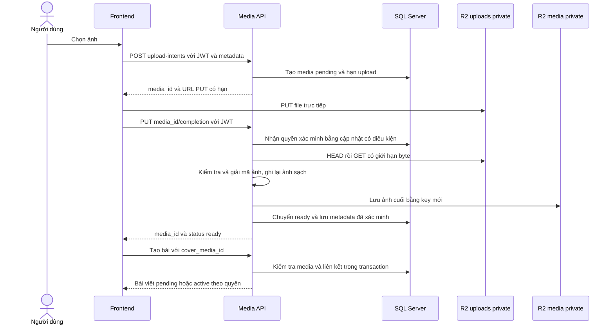
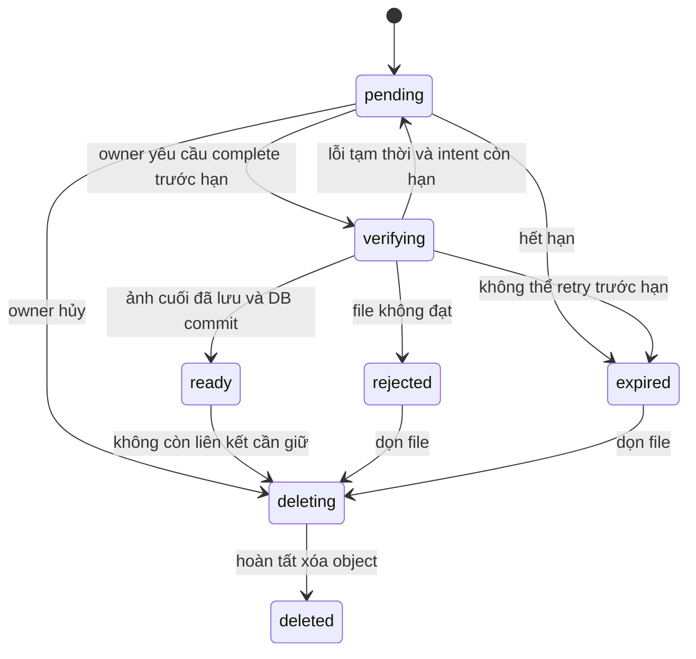

# UITConnect V2 Media R2 Design

> Bản nháp thiết kế MD-01 cho bước A, chờ Bình và API-01 review. API R2, DTO và chính sách dưới đây là đề xuất, chưa phải chức năng đã triển khai hoặc contract REST đã công bố.

| Nội dung | Giá trị |
| --- | --- |
| Issue | [MD-01 Cloudflare R2 Storage và Secure Media Upload](https://github.com/zaabinh/SE347-UITConnect/issues/5) |
| Implementation owner | Đông, `@QuangDong-2006` |
| Cloudflare và architecture reviewer | Bình, `@zaabinh` |
| Nhánh làm việc | `feature/cloudflare-r2-media-upload` |
| Baseline ứng dụng trên nhánh thiết kế | `6b638b5`, tạo từ `develop` |
| Chuẩn API tham chiếu | [API-01 tại a28fd49](https://github.com/zaabinh/SE347-UITConnect/blob/a28fd49147f4012d03438c1fa33262261425cff1/docs/API_CONTRACT.md) |
| Cập nhật | 21/11/2026; bản thiết kế chờ review, implementation chưa bắt đầu |

Đây là tài liệu Markdown duy nhất trên nhánh nhiệm vụ MD-01. Người review bắt đầu ở phần tổng quan, xem sơ đồ lifecycle và bảng endpoint, sau đó đọc contract/DTO và ghi quyết định ở cuối tài liệu.

API-01 mô tả contract REST của mã nguồn trên nhánh `refactor/api-standard`; MD-01 kế thừa quy ước trình bày và thiết kế API của nhánh đó. Bản tham chiếu có OpenAPI candidate, chưa phải approved baseline hoặc bằng chứng đã chạy staging/production. Các API R2 trong tài liệu này vẫn là đề xuất bước A.

## Mục lục

1. [Tổng quan](#1-tổng-quan-overview)
2. [Tiêu chuẩn thiết kế API](#2-tiêu-chuẩn-thiết-kế-api-api-design-standards)
3. [Tóm tắt endpoint](#3-tóm-tắt-endpoint-api-endpoint-summary)
4. [Vòng đời upload](#4-vòng-đời-upload-upload-lifecycle)
5. [Hợp đồng API Media](#5-hợp-đồng-api-media-media-api-contracts)
6. [DTO và kiểu dữ liệu](#6-dto-và-kiểu-dữ-liệu-dtos-and-data-types)
7. [Mã lỗi](#7-mã-lỗi-error-codes)
8. [Phân quyền và tích hợp bài viết](#8-phân-quyền-và-tích-hợp-bài-viết-authorization-and-post-integration)
9. [Chính sách storage](#9-chính-sách-storage-storage-policies)
10. [Metadata và schema](#10-metadata-và-schema-metadata-and-database-schema)
11. [Adapter và vận hành](#11-adapter-và-vận-hành-adapter-and-operations)
12. [Tương thích và migration](#12-tương-thích-và-migration-compatibility-and-migration)
13. [Kiểm chứng thiết kế](#13-kiểm-chứng-thiết-kế-design-verification)
14. [Inventory frontend dự kiến](#14-inventory-frontend-dự-kiến-frontend-integration-inventory)
15. [Checklist tương thích triển khai](#15-checklist-tương-thích-triển-khai-deployment-compatibility-checklist)
16. [Các quyết định cần review](#16-các-quyết-định-cần-review-review-decisions)

## 1. Tổng quan (Overview)

UITConnect sẽ lưu ảnh lâu dài trên R2 và metadata trong SQL Server. Browser upload trực tiếp vào bucket private tạm; backend xác minh dữ liệu thực tế rồi tạo ảnh cuối có key riêng. Chỉ media đã xác minh mới được gắn vào bài viết; quyền xem được tính riêng theo user và bài viết.

### 1.1. Hiện trạng và điểm tích hợp

Bảng dưới mô tả baseline `6b638b5` trên nhánh R2. Trên nhánh API-01 tại `a28fd49`, backend đã chuyển sang `app/modules/media`, frontend có `uploadImage(file)`, và `POST /api/v1/media/images` đã yêu cầu active_user, kiểm tra MIME/signature cùng giới hạn file 5 MiB. Endpoint đó vẫn lưu filesystem, chưa có upload intent, metadata ownership hoặc lifecycle private R2. Xem [Media API hiện có](https://github.com/zaabinh/SE347-UITConnect/blob/a28fd49147f4012d03438c1fa33262261425cff1/backend/app/modules/media/application.py).

| Vị trí | Hiện trạng | Thay đổi cần thiết |
| --- | --- | --- |
| [PostEditor.tsx](../frontend/components/post/PostEditor.tsx) | Dùng `FileReader.readAsDataURL` khi chọn ảnh | Giữ preview trên máy, thực hiện upload R2 trước khi gửi bài |
| [Trang tạo bài](../frontend/app/create/page.tsx) và [trang sửa bài](../frontend/app/edit/%5Bid%5D/page.tsx) | Truyền ảnh qua `cover_image` | Gửi định danh media đã được xác minh |
| [Upload router](../backend/routers/upload.py) | `POST /upload/image` ghi file local, chưa kiểm tra đăng nhập | Thay bằng Media API có xác thực và kiểm tra ownership |
| [Backend entrypoint](../backend/main.py) | Mount thư mục local thành `/uploads` | Loại bỏ phụ thuộc này cho media persistent trên production sau khi chuyển dữ liệu |
| [Post schema](../backend/schemas/post_schema.py), [post router](../backend/routers/post.py) và [Post model](../backend/models/post.py) | Nhận/lưu `cover_image` dạng chuỗi | Thêm liên kết media và validate ở backend |
| [AvatarPicker](../frontend/components/ui/AvatarPicker.tsx) và [profile API](../backend/routers/user.py) | Avatar cũng có thể dùng Data URL; profile nhận `avatar_url` | Tích hợp lại Media API ở giai đoạn sau |
| [Database upgrade script](../backend/scripts/upgrade_db.py) | Baseline nhánh R2 còn cơ chế chạy SQL upgrade thủ công | Khi tích hợp API-01, kế thừa Alembic đã có và thêm revision Media |

Luồng hiện tại: người dùng chọn ảnh → frontend tạo Data URL → gửi trong JSON tạo bài → backend lưu chuỗi vào `posts.cover_image`. API upload local là một luồng khác, chưa có bước cấp phép và xác minh object như yêu cầu MD-01.

Phạm vi triển khai đầu tiên là ảnh bìa bài viết. Thiết kế để mở rộng cho avatar sau khi luồng cốt lõi ổn định. Logo UITConnect là public asset do Bình phối hợp quản lý. Video, tài liệu, chỉnh sửa ảnh nâng cao và dịch vụ quét nội dung tự động nằm ngoài phạm vi này.

### 1.2. Phân công

| Thành viên | Trách nhiệm |
| --- | --- |
| Đông | Metadata, Media API, adapter, verification, ownership, migration phối hợp DB, tests và tài liệu |
| Bình | Bucket, credentials, CORS, domain, review security và cấu hình staging/production |
| Na | Phối hợp Đông tích hợp UI chọn ảnh, tiến trình upload, lỗi và thay Data URL persistent |
| API-01 | Thống nhất route, DTO, mã lỗi và thay đổi contract bài viết |
| Người phụ trách database | Review FK/index, migration nối tiếp baseline API-01, upgrade và chuyển dữ liệu cũ |

### 1.3. Các khái niệm

Đông có thể đọc từ hiện trạng đến lifecycle trước, sau đó đọc metadata và API. Bình tập trung vào bucket, quyền truy cập, xác minh và cấu hình. API-01 và Na review phần contract cùng cách tích hợp bài viết.

| Khái niệm | Ý nghĩa trong thiết kế |
| --- | --- |
| Object storage | Dịch vụ lưu file, ở đây là Cloudflare R2 |
| Bucket | Kho chứa object với cấu hình truy cập riêng |
| Object key | Tên định danh file trong bucket, do backend sinh |
| Metadata | Bản ghi SQL chứa chủ sở hữu, trạng thái và thông tin kiểm tra file |
| Upload intent | Yêu cầu upload đã được backend cấp phép và ghi nhận |
| Presigned URL | URL có chữ ký cấp quyền tạm thời cho một thao tác trên một object |
| Storage Adapter | Lớp giao tiếp R2, tách khỏi nghiệp vụ kiểm tra quyền và quản lý media |
| Idempotent | Gọi lại thao tác không tạo thêm ảnh hoặc liên kết ngoài ý muốn |

## 2. Tiêu chuẩn thiết kế API (API Design Standards)

Base URL local: `http://localhost:8000`. Endpoint ứng dụng dùng `{BASE_URL}/api/v1`; URL PUT/GET R2 là capability ngoài API ứng dụng. Path chữ thường, resource dạng danh từ, kebab-case và không trailing slash. Mỗi operation có `operation_id` riêng theo mẫu `media_{operation}`.

Request/response ứng dụng là `application/json`; lỗi là `application/problem+json` với `ProblemDetails`. Không thêm envelope `error` riêng. Request tới R2 gửi raw binary, không multipart và không gửi JWT UITConnect. API mới kế thừa chuẩn chung của [API-01](https://github.com/zaabinh/SE347-UITConnect/blob/a28fd49147f4012d03438c1fa33262261425cff1/docs/API_CONTRACT.md); các thay đổi Media phải được đưa vào contract chung sau khi review và có implementation.

| Nội dung | Quy ước đề xuất cho MD-01 |
| --- | --- |
| Xác thực | `Authorization: Bearer <access_token>`; user active và profile hoàn tất; không tự bật yêu cầu xác minh email |
| Success | 201 tạo intent; 200 xác minh xong hoặc cấp quyền đọc; 202 đang xác minh/đang xóa; 204 xóa đã hoàn tất, không body |
| Headers | API trả `X-Request-ID` do server tạo; 401 có `WWW-Authenticate: Bearer`; response chứa signed URL có `Cache-Control: no-store` |
| Retry | PUT completion và DELETE có kết quả ổn định theo trạng thái; POST intent lặp có thể tạo intent mới, không có `Idempotency-Key` |
| Parameter | `media_id` là UUID; không nhận key, bucket hoặc owner từ client |
| DTO request | Từ chối extra field; required độc lập với nullable; giới hạn được định nghĩa ở mục 6 và mục 9 |
| Ngày giờ | `UtcDateTime`, ISO 8601 UTC có `Z`; dùng đồng hồ backend cho expiration |
| Quota | Quota và 429 ở mục 9 là phần cần triển khai trong MD-01, không phải tính năng hiện có của API-01 |
| Request ID | Chỉ API ứng dụng cấp `X-Request-ID`; không giả định response R2 có cùng header hoặc cùng error format |

Hướng tích hợp backend là module `app/modules/media`: router phân tích request, application service điều phối, domain kiểm tra quy tắc, repository lưu metadata và Unit of Work chốt transaction. Storage Adapter thực hiện I/O R2 ngoài transaction SQL kéo dài. Phần này tham chiếu [transaction architecture của API-01](https://github.com/zaabinh/SE347-UITConnect/blob/a28fd49147f4012d03438c1fa33262261425cff1/docs/BACKEND_TRANSACTIONS.md); cấu trúc modular monolith chưa được đưa vào nhánh R2 hiện tại.

## 3. Tóm tắt endpoint (API Endpoint Summary)

| Method | Endpoint | Description | Authentication | Request DTO | Response DTO | Status |
| --- | --- | --- | --- | --- | --- | --- |
| `POST` | `/api/v1/media/upload-intents` | Cấp phép upload ảnh vào R2 tạm | active_user | `CreateUploadIntentRequest` | `UploadIntentResponse` | 201 |
| `PUT` | `/api/v1/media/{media_id}/completion` | Xác minh upload và đặt media vào trạng thái ready | active_user, owner | Không body | `MediaReadyResponse` hoặc `MediaVerifyingResponse` | 200, 202 |
| `GET` | `/api/v1/media/{media_id}/access-url` | Cấp URL đọc sau khi kiểm tra visibility | active_user, visibility | Không body | `MediaAccessUrlResponse` | 200 |
| `DELETE` | `/api/v1/media/{media_id}` | Xóa media không còn liên kết cần giữ | active_user, owner | Không body | `MediaDeletionResponse` hoặc không body | 202, 204 |

Đây là bốn endpoint đề xuất cho MD-01. Request `PUT` binary từ browser đến URL R2 không phải endpoint REST của UITConnect. Endpoint chuyển tiếp `POST /api/v1/media/images` của API-01 vẫn đang upload filesystem; kế hoạch thay thế ở mục 12.

## 4. Vòng đời upload (Upload Lifecycle)

### Luồng thành công



URL có chữ ký cấp một thao tác trên một object và có thể dùng lại đến khi hết hạn. Do đó, hoàn tất upload không đồng nghĩa URL PUT đã bị thu hồi. [Nguồn Cloudflare về presigned URL](https://developers.cloudflare.com/r2/api/s3/presigned-urls/).

Browser chỉ có URL ghi bucket uploads. Backend đọc một snapshot có giới hạn vào bộ nhớ, xác minh và tạo ảnh cuối từ chính snapshot đó. Không thực hiện `HEAD` rồi copy mù object tạm, vì object có thể thay đổi giữa hai thao tác. File tạm bị ghi lại sau đó không thể thay đổi ảnh cuối đã được chấp nhận.

Đây là lý do bảo mật để backend đọc và ghi lại ảnh ở bước verification. Dữ liệu upload ban đầu vẫn đi trực tiếp từ browser đến R2. Không dùng local filesystem làm nơi lưu persistent hoặc fallback; dữ liệu kiểm tra chỉ tồn tại trong bộ nhớ có giới hạn.

### Trạng thái



`ready` nghĩa là ảnh hợp lệ và có thể gắn vào bài; quyền đọc được tính riêng. Liên kết với bài không phải một trạng thái media mới. Khi xóa lúc URL PUT còn hiệu lực, media giữ `deleting` cho đến khi qua hạn URL và buffer; chỉ chuyển `deleted` sau lần dọn cuối.

### Các bước xác minh

1. Xác thực user hiện tại, kiểm tra owner, purpose, trạng thái và hạn bằng đồng hồ backend theo UTC. Tái sử dụng điều kiện user active, đã hoàn tất profile trong [auth dependency](../backend/dependencies/auth.py). Tên dependency có chữ `verified` nhưng code hiện không yêu cầu xác minh email.
2. Chuyển `pending` sang `verifying` bằng cập nhật có điều kiện; cấp `verification_token` và lease 120 giây. Chỉ một verifier thắng. Không giữ transaction SQL mở trong lúc gọi R2 hoặc xử lý ảnh.
3. Dùng `HEAD` để phát hiện object thiếu/quá lớn; đọc một lần với giới hạn tối đa `MAX_BYTES + 1`. Đếm byte thực nhận và so sánh với `declared_size_bytes`, không chỉ tin metadata R2.
4. Kiểm tra extension đã chuẩn hóa, MIME đã ký và nội dung thực. Đọc signature chỉ là bước đầu; phải giải mã ảnh đầy đủ, giới hạn frame, chiều và tổng pixel. Cấm SVG, GIF, WebP, file hỏng và ảnh nhiều frame trong scope đầu.
5. Chỉnh orientation trước khi bỏ EXIF, ghi lại JPEG/PNG từ pixel đã giải mã, loại bỏ metadata ngoài chính sách và kiểm tra lại kích thước output. Decoder có giới hạn thời gian/bộ nhớ và concurrency; không chạy tác vụ đồng bộ nặng trực tiếp trên event loop.
6. Tính SHA-256 của ảnh cuối, lưu vào media bucket bằng key của attempt. Cập nhật metadata và `ready` chỉ khi `verification_token` vẫn khớp, user vẫn đủ điều kiện và trạng thái chưa bị thu hồi.
7. Commit thành công mới trả `ready`. Nếu mất quyền cập nhật hoặc commit thất bại, ảnh vừa ghi là orphan private cần dọn; không trả thành công. Job thu hồi lease hết hạn bằng cập nhật có điều kiện; worker cũ không thể commit bằng token đã thay.

Kiểm tra nhiều lớp và không tin `Content-Type` phù hợp với [OWASP File Upload Cheat Sheet](https://cheatsheetseries.owasp.org/cheatsheets/File_Upload_Cheat_Sheet.html). Đề xuất dùng Pillow cho decoder, bật lỗi cho cảnh báo decompression bomb và đặt ngưỡng pixel của ứng dụng; [tài liệu Pillow](https://pillow.readthedocs.io/en/stable/reference/Image.html#PIL.Image.open) mô tả cơ chế cảnh báo này. Tính khả thi của ngưỡng timeout và bộ nhớ cần smoke test trên cấu hình Render thực tế.

## 5. Hợp đồng API Media (Media API Contracts)

Các field, kiểu dữ liệu và nullability được định nghĩa ở mục 6. Tất cả ví dụ dùng ID/URL minh họa, không có credentials dùng được.

### `POST /api/v1/media/upload-intents` — Tạo upload intent

**Định danh:** operation_id `media_create_upload_intent`; module `media`.

**Xác thực và quyền:** Bearer access JWT, active_user. Owner lấy từ user hiện tại trong DB. Kiểm tra quota trước khi cấp capability.

**Request:** `Content-Type: application/json`, `Accept: application/json`; body bắt buộc `CreateUploadIntentRequest`. Không có path/query parameter.

```json
{
  "purpose": "post_cover",
  "filename": "anh-uit.png",
  "content_type": "image/png",
  "size_bytes": 123456
}
```

**Response:** `201`, `application/json`, `UploadIntentResponse`; `X-Request-ID` và `Cache-Control: no-store`.

```json
{
  "media_id": "99c4c396-8724-4dbb-9aa8-b909b80e81d7",
  "status": "pending",
  "upload": {
    "method": "PUT",
    "url": "https://example.invalid/presigned-upload-placeholder",
    "headers": { "Content-Type": "image/png" },
    "expires_at": "2026-11-21T03:05:00Z",
    "max_size_bytes": 5242880
  }
}
```

**Lỗi:** 401/403/404 theo auth chung; 413 `PAYLOAD_TOO_LARGE`; 415 `MEDIA_TYPE_NOT_ALLOWED`; 422 `VALIDATION_ERROR`; 429 `RATE_LIMITED` khi quota MD-01 được triển khai; 503 `MEDIA_STORAGE_UNAVAILABLE`; 500 `INTERNAL_ERROR` khi có lỗi không dự kiến. Schema request lỗi không tạo media.

**Hành vi, side effect và retry:** Tạo metadata `pending`, tự sinh key, ký PUT đúng uploads bucket, key và `Content-Type` đã chuẩn hóa. DB phải commit trước khi trả URL. Client không được chọn owner/bucket/key. POST lặp có thể tạo nhiều intent; không retry mù sau timeout. Bản ghi không được sử dụng sẽ được cleanup. Hết hạn phải xin intent mới, không gia hạn URL cũ.

### PUT binary trực tiếp đến R2

Browser dùng `upload.method`, `upload.url`, `upload.headers` để gửi raw `File`. Dùng `fetch` hoặc client HTTP riêng; không dùng `FormData` và không tái sử dụng Axios instance có JSON header/auth interceptor. Không gửi access JWT UITConnect đến R2.

Response `2xx` từ R2 không đánh dấu media `ready`. Sau upload, gọi PUT completion. Nếu PUT timeout nhưng chưa rõ R2 đã nhận file chưa, gọi completion để kiểm tra trước khi upload lại. CORS và lỗi R2 độc lập với `ProblemDetails` của API ứng dụng.

### `PUT /api/v1/media/{media_id}/completion` — Xác minh upload

**Định danh:** operation_id `media_complete_upload`; module `media`. Dùng PUT cho yêu cầu đạt trạng thái hoàn tất; gọi lại không tạo thêm ảnh cuối đã được chấp nhận.

**Xác thực và quyền:** active_user, owner. Không tiết lộ sự tồn tại của media cho user không phải owner.

**Request:** path `media_id: UUID`; `Accept: application/json`; không có body/query parameter. Không nhận kết luận file hợp lệ, key hoặc dung lượng thực từ client.

**Response:** `200`, `MediaReadyResponse` khi đã hoàn tất; gọi lại trả cùng metadata. Mọi response API có `X-Request-ID`.

```json
{
  "media_id": "99c4c396-8724-4dbb-9aa8-b909b80e81d7",
  "status": "ready",
  "content_type": "image/png",
  "size_bytes": 120000,
  "width": 1200,
  "height": 800
}
```

Nếu đã có verifier đang sở hữu lease, trả `202`, `MediaVerifyingResponse`, `Retry-After: 2`:

```json
{
  "media_id": "99c4c396-8724-4dbb-9aa8-b909b80e81d7",
  "status": "verifying",
  "retry_after_seconds": 2
}
```

**Lỗi:** auth chung; 404 `NOT_FOUND` nếu thiếu/khác owner/đã deleted; 409 `MEDIA_NOT_UPLOADED` khi object chưa tồn tại; 409 `MEDIA_STATE_CONFLICT` nếu đang deleting; 410 `MEDIA_UPLOAD_EXPIRED`; 413 `PAYLOAD_TOO_LARGE`; 415 `MEDIA_TYPE_NOT_ALLOWED`; 422 `MEDIA_INVALID_IMAGE` hoặc `MEDIA_METADATA_MISMATCH`; 503 lỗi verification/storage tạm thời; 500 lỗi không dự kiến.

**Hành vi, side effect và retry:** Claim lease có điều kiện, đọc snapshot bounded, decode và ghi lại ảnh, lưu private final object rồi commit metadata theo token của attempt. Không giữ transaction SQL trong lúc đọc/ghi R2. Caller thứ hai nhận 202 hoặc cùng kết quả ready. Nếu đã ready thì trả 200 dù URL PUT cũ hết hạn; nếu chưa bắt đầu verification trước hạn thì trả 410. File vi phạm chuyển rejected, gọi lại trả cùng mã lỗi. Object chưa tồn tại hoặc hạ tầng lỗi có thể retry khi intent còn hạn; worker cũ không được commit khi đã mất lease.

### `GET /api/v1/media/{media_id}/access-url` — Cấp quyền đọc

**Định danh:** operation_id `media_get_access_url`; module `media`.

**Xác thực và quyền:** active_user và đạt ma trận visibility ở mục 8; media phải ready. Chưa đăng nhập không được cấp URL.

**Request:** path `media_id: UUID`; không body/query parameter; `Accept: application/json`.

**Response:** `200`, `MediaAccessUrlResponse`; `X-Request-ID` và `Cache-Control: no-store`.

```json
{
  "media_id": "99c4c396-8724-4dbb-9aa8-b909b80e81d7",
  "url": "https://example.invalid/presigned-read-placeholder",
  "expires_at": "2026-11-21T03:06:00Z"
}
```

**Lỗi:** auth chung; 404 `NOT_FOUND` nếu media thiếu, deleted hoặc không có visibility; 409 `MEDIA_NOT_READY` cho người có quyền quản lý media nhưng ảnh chưa ready; 503 `MEDIA_STORAGE_UNAVAILABLE`; 500 lỗi không dự kiến.

**Hành vi, side effect và retry:** Chỉ kiểm tra quyền và ký GET cho final key, không sửa trạng thái/metadata. URL có hạn 60 giây, không lưu làm định danh persistent. Gọi lại có thể nhận URL mới; quyền được kiểm tra lại mỗi lần cấp. Object cuối dùng MIME đã xác minh, `Content-Disposition: inline` với tên backend sinh, `Cache-Control: private, no-store`. URL đã cấp còn dùng được đến hạn; giới hạn thu hồi nêu ở mục 8.

### `DELETE /api/v1/media/{media_id}` — Xóa media

**Định danh:** operation_id `media_delete`; module `media`.

**Xác thực và quyền:** active_user, owner. Media không còn liên kết đang sử dụng hoặc thời gian giữ phục hồi.

**Request:** path `media_id: UUID`; không body/query parameter.

**Response:** `202`, `MediaDeletionResponse` khi đã nhận yêu cầu; `204`, không body khi owner gọi lại sau khi xóa xong. Mọi response API có `X-Request-ID`.

```json
{
  "media_id": "99c4c396-8724-4dbb-9aa8-b909b80e81d7",
  "status": "deleting"
}
```

**Lỗi:** auth chung; 404 `NOT_FOUND` nếu thiếu/khác owner; 409 `MEDIA_IN_USE` nếu còn liên kết hoặc thời hạn giữ; 409 `MEDIA_VERIFYING` nếu verifier còn lease; 500 lỗi không dự kiến.

**Hành vi, side effect và retry:** Commit trạng thái deleting, chặn complete/read mới và để job xóa object bằng backend credentials. Không cấp presigned DELETE cho browser. Chưa coi file tạm đã xóa vĩnh viễn khi URL PUT còn hiệu lực; job dọn sau expiry và buffer. Lỗi xóa R2 giữ deleting và retry có backoff. Tombstone giữ owner để DELETE lặp có kết quả ổn định.

## 6. DTO và kiểu dữ liệu (DTOs and Data Types)

Đây là các DTO dự kiến cho implementation MD-01. Bảng chưa được sinh từ OpenAPI; khi triển khai cần bổ sung schemas thật, OpenAPI và kiểm tra contract chung. **Bắt buộc** nghĩa là key phải xuất hiện, độc lập với **Nullable**. UUID biểu diễn bằng string chuẩn; datetime dùng `UtcDateTime`. Tất cả DTO request Media mới từ chối extra field.

### `CreateUploadIntentRequest`

| Field | Kiểu | Bắt buộc | Nullable | Ràng buộc | Ý nghĩa |
| --- | --- | --- | --- | --- | --- |
| `purpose` | string | Có | Không | enum `post_cover` trong lần tích hợp đầu | Mục đích media |
| `filename` | string | Có | Không | 1–255 ký tự, tên file an toàn và extension allowlist | Tên gốc, không dùng làm object key |
| `content_type` | string | Có | Không | `image/jpeg` hoặc `image/png` | MIME khai báo; vẫn phải xác minh nội dung |
| `size_bytes` | integer | Có | Không | 1–5242880 | Dung lượng client khai báo |

### `UploadIntentResponse`

| Field | Kiểu | Bắt buộc | Nullable | Ràng buộc | Ý nghĩa |
| --- | --- | --- | --- | --- | --- |
| `media_id` | string UUID | Có | Không | ID backend sinh | Định danh media |
| `status` | string | Có | Không | enum `pending` | Trạng thái vừa tạo |
| `upload` | `PresignedUpload` | Có | Không | Xem bảng dưới | Capability upload tạm |

### `PresignedUpload`

| Field | Kiểu | Bắt buộc | Nullable | Ràng buộc | Ý nghĩa |
| --- | --- | --- | --- | --- | --- |
| `method` | string | Có | Không | enum `PUT` | HTTP method phải dùng |
| `url` | string URI | Có | Không | HTTPS S3 endpoint R2 của môi trường | URL có chữ ký, không log/lưu persistent |
| `headers` | object string → string | Có | Không | Có `Content-Type` đúng MIME đã ký | Headers browser phải gửi |
| `expires_at` | UtcDateTime | Có | Không | Hạn 300 giây từ lúc cấp | Mốc URL và intent hết hiệu lực |
| `max_size_bytes` | integer | Có | Không | 5242880 trong chính sách đầu | Giới hạn chấp nhận, không cam kết hard limit ingress |

### `MediaReadyResponse`

| Field | Kiểu | Bắt buộc | Nullable | Ràng buộc | Ý nghĩa |
| --- | --- | --- | --- | --- | --- |
| `media_id` | string UUID | Có | Không | ID intent | Media đã được chấp nhận |
| `status` | string | Có | Không | enum `ready` | Xác minh thành công |
| `content_type` | string | Có | Không | `image/jpeg` hoặc `image/png` | Định dạng ảnh cuối |
| `size_bytes` | integer | Có | Không | 1–5242880 | Số byte ảnh cuối, có thể khác file đầu vào |
| `width` | integer | Có | Không | 1–4096 | Chiều rộng pixel |
| `height` | integer | Có | Không | 1–4096; width × height ≤ 16000000 | Chiều cao pixel |

### `MediaVerifyingResponse`

| Field | Kiểu | Bắt buộc | Nullable | Ràng buộc | Ý nghĩa |
| --- | --- | --- | --- | --- | --- |
| `media_id` | string UUID | Có | Không | ID intent | Media đang xử lý |
| `status` | string | Có | Không | enum `verifying` | Một verifier đã claim lease |
| `retry_after_seconds` | integer | Có | Không | Giá trị đề xuất 2 | Khoảng chờ trước khi gọi lại completion |

### `MediaAccessUrlResponse`

| Field | Kiểu | Bắt buộc | Nullable | Ràng buộc | Ý nghĩa |
| --- | --- | --- | --- | --- | --- |
| `media_id` | string UUID | Có | Không | Media ready, có visibility | Định danh ảnh được xem |
| `url` | string URI | Có | Không | HTTPS signed GET | Capability xem ảnh cuối |
| `expires_at` | UtcDateTime | Có | Không | Hạn 60 giây từ lúc cấp | Thời điểm frontend phải xin mới |

### `MediaDeletionResponse`

| Field | Kiểu | Bắt buộc | Nullable | Ràng buộc | Ý nghĩa |
| --- | --- | --- | --- | --- | --- |
| `media_id` | string UUID | Có | Không | ID media của owner | Đối tượng đang xóa |
| `status` | string | Có | Không | enum `deleting` | Đã chặn sử dụng mới, chờ xóa vật lý |

### Thay đổi DTO bài viết

| DTO | Field | Kiểu | Bắt buộc | Nullable | Quy tắc |
| --- | --- | --- | --- | --- | --- |
| `CreatePostRequest` | `cover_media_id` | string UUID | Không | Có | Không gửi/null: bài không có ảnh; UUID: kiểm tra ownership và ready |
| `UpdatePostRequest` | `cover_media_id` | string UUID | Không | Có | Omitted giữ nguyên; null gỡ ảnh; UUID thay ảnh trong cùng transaction |
| `PostResponse` | `cover_media_id` | string UUID | Có | Có | ID persistent; không nhúng signed URL dài hạn |

`UpdatePostRequest` được gọi bằng `PATCH /api/v1/posts/{post_id}` theo API-01. Các field title/content/tags và quy tắc empty PATCH giữ theo contract chung. Bổ sung cover_media_id phải được API-01 review cùng thời điểm xử lý field legacy cover_image.

### DTO dùng chung

Tái sử dụng `ProblemDetails` và `UtcDateTime` của [shared schemas API-01](https://github.com/zaabinh/SE347-UITConnect/blob/a28fd49147f4012d03438c1fa33262261425cff1/backend/app/core/schemas.py). `ProblemDetails` có type, title, status, detail, instance, code, request_id; errors chỉ dùng khi có lỗi validation. Không nhân bản một schema lỗi riêng cho Media.

## 7. Mã lỗi (Error Codes)

Lỗi ứng dụng trả `application/problem+json` và cùng `X-Request-ID` trong header/body. Không trả input nhạy cảm, body R2, stack trace hoặc signed URL trong lỗi. Lỗi từ 500 trở lên giữ detail chung `Internal server error.` theo API-01.

```json
{
  "type": "about:blank",
  "title": "Gone",
  "status": 410,
  "detail": "Upload intent has expired. Create a new upload intent.",
  "instance": "/api/v1/media/99c4c396-8724-4dbb-9aa8-b909b80e81d7/completion",
  "code": "MEDIA_UPLOAD_EXPIRED",
  "request_id": "44444444-4444-4444-8444-444444444444"
}
```

| Code | HTTP | Điều kiện và hành vi |
| --- | --- | --- |
| `UNAUTHORIZED` | 401 | Thiếu/sai/hết hạn access JWT; có WWW-Authenticate |
| `FORBIDDEN` | 403 | Banned/inactive hoặc chưa hoàn tất profile |
| `NOT_FOUND` | 404 | User session deleted, media thiếu/deleted hoặc không có ownership/visibility |
| `CONCURRENT_MODIFICATION` | 409 | Không nhận được aggregate lock theo cơ chế Unit of Work của API-01 |
| `MEDIA_NOT_UPLOADED` | 409 | Không thấy object, có thể retry khi intent còn hạn |
| `MEDIA_NOT_READY` | 409 | Người có quyền quản lý xin access URL trước khi ảnh ready |
| `MEDIA_IN_USE` | 409 | Xóa media đang liên kết hoặc trong thời hạn giữ |
| `MEDIA_VERIFYING` | 409 | Xóa khi verifier còn lease; completion đồng thời dùng 202 |
| `MEDIA_STATE_CONFLICT` | 409 | Hoàn tất media đang deleting hoặc trạng thái không cho phép |
| `MEDIA_UPLOAD_EXPIRED` | 410 | Intent chưa được verifier claim trước hạn; cần intent mới |
| `PAYLOAD_TOO_LARGE` | 413 | Dung lượng khai báo, thực tế hoặc ảnh cuối vượt 5 MiB |
| `MEDIA_TYPE_NOT_ALLOWED` | 415 | MIME/extension/định dạng ngoài allowlist |
| `VALIDATION_ERROR` | 422 | Sai UUID/kiểu, thiếu field, extra field, request không hợp schema |
| `MEDIA_INVALID_IMAGE` | 422 | Decode lỗi, ảnh nhiều frame hoặc vượt chiều/pixel |
| `MEDIA_METADATA_MISMATCH` | 422 | Nội dung/byte thực tế không khớp khai báo |
| `RATE_LIMITED` | 429 | Quota MD-01 vượt ngưỡng sau khi limiter được triển khai; có Retry-After |
| `MEDIA_STORAGE_UNAVAILABLE` | 503 | R2 không sẵn sàng, không trả ready |
| `MEDIA_VERIFICATION_UNAVAILABLE` | 503 | Không thể xử lý ảnh vì lỗi hạ tầng tạm thời |
| `INTERNAL_ERROR` | 500 | Lỗi không dự kiến; detail không tiết lộ nội bộ |

Các code `MEDIA_*`, status 410/415/503 và quota là phần mở rộng đề xuất cần API-01 xác nhận. Không suy ra API-01 hiện có quota hoặc các endpoint R2 này. Rejected lưu failure_code ổn định; gọi lại completion trả cùng lỗi. Browser có thể không đọc được body lỗi R2 do CORS; UI xử lý lỗi upload theo trạng thái request, không giả định R2 trả ProblemDetails.

## 8. Phân quyền và tích hợp bài viết (Authorization and Post Integration)

### Ma trận quyền đọc

| Tình trạng media và bài | Owner | Admin đủ điều kiện | User active có profile khác | Chưa đăng nhập |
| --- | --- | --- | --- | --- |
| `pending`, `verifying`, `rejected`, `expired`, `deleting`, `deleted` | Không cấp URL ảnh | Không cấp URL ảnh | Không cấp URL ảnh | Không |
| `ready`, chưa gắn bài | Có | Có, cho review | Không | Không |
| `ready`, bài `pending` hoặc `rejected` | Có | Có | Không | Không |
| `ready`, bài `active` | Có | Có | Có | Không |
| Bài `deleted` | Không cấp URL mới | Không cấp URL mới | Không | Không |

Chính sách active/profile phù hợp dependency hiện tại. `is_verified` email không được tự thêm thành điều kiện trong task này. Các route bài hiện cho chủ bài/admin đọc bài không active; chính sách ảnh cho bài deleted ở đây siết hơn và cần nhóm review.

Share dùng quyền bài gốc cùng với quyền bài share khi hiển thị. Nếu bài gốc mất quyền đọc, share không được cấp mới URL ảnh gốc. Một URL GET đã cấp vẫn là capability có thể chuyển tiếp và dùng đến hạn 60 giây, kể cả khi bài bị ẩn hoặc user bị ban sau đó. Nếu yêu cầu thu hồi tức thì, cần chuyển đường đọc qua gateway kiểm tra quyền từng request và review lại thiết kế; TTL không cung cấp thu hồi tức thì.

### Contract bài viết

Request tạo bài thêm `cover_media_id` nullable. Khi sửa: thiếu trường nghĩa giữ ảnh hiện tại; `null` nghĩa gỡ ảnh; UUID nghĩa thay bằng media đã xác minh của owner. Ví dụ:

```json
{
  "title": "Chia sẻ trải nghiệm học tại UIT",
  "content": "Nội dung bài viết",
  "cover_media_id": "99c4c396-8724-4dbb-9aa8-b909b80e81d7",
  "tags": []
}
```

Backend từ chối Data URL/URL tùy ý làm ảnh mới và từ chối client gửi đồng thời trường cũ `cover_image` với `cover_media_id`. PostCreate/PostUpdate không dùng URL làm bằng chứng ownership. Response bài trả `cover_media_id`; frontend xin access URL sau khi nhận quyền xem bài. `cover_image` cũ chỉ phục vụ giai đoạn chuyển đổi đã thống nhất, không phải local persistent fallback.

Đồng bộ DTO và serializer cho feed, chi tiết bài, bài trong profile, share, create/edit. Ảnh đổi phải tạo media mới; không sửa object cuối đang được bài khác đọc. Sau transaction thay/gỡ ảnh thành công, ảnh cũ trở thành orphan và được giữ 24 giờ trước khi dọn nếu không còn liên kết. Frontend có các trạng thái `uploading`, `verifying`, `ready`, `error`; khóa gửi bài khi ảnh đang upload/xác minh. Preview dùng object URL và thu hồi khi không cần.

Ảnh private có URL ngắn hạn không đi qua đường tối ưu ảnh cache công khai. Na cần cấu hình cách render phù hợp, ví dụ dùng ảnh trực tiếp hoặc Next Image với `unoptimized` và hostname allowlist hẹp; không dùng image optimizer để biến ảnh private thành URL cache dài hạn. Khi stale URL bị từ chối, xin lại access URL thay vì tạo lại intent.

## 9. Chính sách storage (Storage Policies)

### 9.1. Giới hạn file và thời hạn

| Nội dung | Giá trị hoặc quy tắc |
| --- | --- |
| Purpose đầu tiên | `post_cover`; chưa mở upload avatar trong lần tích hợp đầu |
| Định dạng | JPEG và PNG một frame; extension `.jpg`, `.jpeg`, `.png` |
| MIME | `image/jpeg`, `image/png`; frontend chuẩn hóa JPEG thành `image/jpeg` |
| Dung lượng đầu vào | Từ 1 đến 5 MiB, tối đa `5242880` byte |
| Giới hạn ảnh giải mã | Tối đa 4096 pixel mỗi chiều và 16000000 pixel tổng cộng |
| Ảnh cuối cùng | JPEG hoặc PNG được backend ghi lại từ dữ liệu đã giải mã; cũng không vượt 5 MiB |
| Tên file gốc | Tối đa 255 ký tự, cấm ký tự điều khiển, separator đường dẫn và tên nhiều phần mở rộng như `photo.exe.png` |
| TTL URL upload | 300 giây; hạn intent dùng cùng mốc thời gian |
| TTL URL xem ảnh | 60 giây; frontend xin URL mới khi cần |
| Giới hạn cấp intent | 10 intent mỗi tài khoản mỗi 10 phút; tối đa 3 intent `pending` hoặc `verifying` đồng thời |
| Ảnh `ready` chưa gắn vào bài | Giữ tối đa 24 giờ tính từ `verified_at` |
| Bài bị soft delete | Ngừng cấp URL mới ngay; giữ liên kết và ảnh 7 ngày trước khi dọn |
| Xử lý file tạm | Job mỗi 10 phút, chỉ dọn sau hạn URL upload cộng 60 giây và không có verifier đang sở hữu lease |

Các con số cần Bình/API-01 xác nhận và đo lại trên staging. Kiểm tra dung lượng ở client giúp trải nghiệm; backend vẫn kiểm tra dữ liệu thực tế. Giới hạn 5 MiB là điều kiện để hệ thống chấp nhận media, không phải cam kết rằng một URL PUT luôn ngăn R2 nhận object lớn hơn. Giới hạn cấp intent và cảnh báo dung lượng giúp giảm lạm dụng; Bình cần chấp nhận giới hạn này hoặc chọn cơ chế ingress có thể chặn dung lượng trước khi lưu.

### 9.2. Bucket và object key

Đề xuất tách ba bucket theo môi trường. Tên dưới đây là ví dụ, Bình cung cấp tên thực tế.

| Bucket ví dụ | Truy cập | Nội dung |
| --- | --- | --- |
| `uitconnect-staging-uploads` | Private | File chưa tin cậy do browser upload |
| `uitconnect-staging-media` | Private | Ảnh đã xác minh, chỉ backend ghi |
| `uitconnect-staging-assets` | Public qua HTTPS domain đã thống nhất | Logo và tài nguyên công khai do nhóm quản lý |

Production dùng bucket riêng, không chia sẻ credentials hoặc dữ liệu với staging. Prefix `pending/` trong một bucket public không tự bảo vệ nội dung. Cloudflare phân biệt bucket private với các cách bật public access; cấu hình public asset phải tách khỏi ảnh người dùng. [Nguồn Cloudflare về public bucket](https://developers.cloudflare.com/r2/buckets/public-buckets/).

Quy ước key:

```text
uploads bucket: pending/{owner_uuid}/{media_uuid}
media bucket:   post-covers/{owner_uuid}/{media_uuid}/{attempt_uuid}.jpg
assets bucket:  branding/uitconnect-logo-v1.png
```

Backend sinh UUID và chọn extension cuối từ định dạng đã xác minh. Client không được chọn bucket, key, owner hoặc URL đích. Mỗi lần xác minh tạo key cuối riêng theo `attempt_uuid`; không ghi đè bản cuối của lần trước.

Logo được kiểm tra thủ công, upload bằng quyền quản trị riêng và bàn giao URL HTTPS ổn định để cấu hình `MAIL_LOGO_URL`. Runtime Media API không có quyền ghi bucket public assets.

## 10. Metadata và schema (Metadata and Database Schema)

Đề xuất bảng `media`, dùng UUID tương thích kiểu `UNIQUEIDENTIFIER` của users. Thời gian dùng UTC; API trả ISO 8601 có `Z`.

| Trường | Kiểu dự kiến | Ý nghĩa |
| --- | --- | --- |
| `id` | UNIQUEIDENTIFIER, PK | Định danh gửi cho frontend |
| `owner_id` | UNIQUEIDENTIFIER, FK users | Chủ upload; lấy từ user đã xác thực |
| `purpose` | VARCHAR(30) | `post_cover`, dự trù `avatar` |
| `status` | VARCHAR(20) | Các trạng thái lifecycle ở trên |
| `upload_key` | VARCHAR(512), unique | Key private tạm, backend sinh |
| `final_key` | VARCHAR(512), nullable, unique khi có | Key cuối của attempt được chấp nhận |
| `original_filename` | NVARCHAR(255) | Tên hiển thị đã kiểm tra |
| `declared_content_type` | VARCHAR(100) | MIME client khai báo đã được chuẩn hóa |
| `declared_size_bytes` | BIGINT | Dung lượng client khai báo |
| `verified_content_type` | VARCHAR(100), nullable | Định dạng nội dung đã xác minh |
| `verified_input_size_bytes` | BIGINT, nullable | Dung lượng đầu vào thực tế |
| `stored_size_bytes` | BIGINT, nullable | Dung lượng ảnh cuối sau ghi lại |
| `width`, `height` | INT, nullable | Kích thước ảnh cuối |
| `sha256` | CHAR(64), nullable | Hash ảnh cuối; không coi ETag là hash nội dung |
| `failure_code` | VARCHAR(50), nullable | Mã lỗi đã làm sạch, không lưu exception R2 |
| `created_at`, `updated_at` | DATETIME2 | Thời gian tạo và cập nhật |
| `upload_expires_at` | DATETIME2 | Hạn cấp quyền upload và bắt đầu verification |
| `verification_token` | UNIQUEIDENTIFIER, nullable | Quyền commit riêng của một attempt |
| `verification_lease_until` | DATETIME2, nullable | Hạn xử lý attempt; không gia hạn URL PUT |
| `verified_at`, `deleted_at` | DATETIME2, nullable | Mốc xác minh/xóa |
| `cleanup_after` | DATETIME2, nullable | Lịch dọn và retry khi xóa thất bại |

Tên bucket lấy từ cấu hình riêng của môi trường, không nhận từ request. Không lưu secret hoặc presigned URL trong bảng. Cần index cho owner/trạng thái, status/hạn upload và cleanup; check constraint cho status, purpose và dung lượng dương.

Thêm `posts.cover_media_id` nullable, FK đến `media.id`. Mỗi media ảnh bìa gắn với tối đa một bài gốc; dùng ràng buộc unique cho giá trị khác NULL phù hợp SQL Server. Share truy xuất ảnh từ bài gốc qua `original_post_id`, không sao chép URL hoặc tạo liên kết cover mới. Việc thay đổi này phải cập nhật cả share route hiện đang copy `cover_image`.

Thao tác gắn/thay ảnh kiểm tra owner, `purpose=post_cover`, `status=ready` và chưa gắn vào bài gốc khác trong cùng transaction. Đọc/khóa bản ghi media theo thứ tự cố định để thao tác attach, delete và job cleanup không cùng thắng. Khi thay ảnh, chỉ bỏ liên kết ảnh cũ sau khi ảnh mới và bài được lưu thành công.

## 11. Adapter và vận hành (Adapter and Operations)

Media service xử lý user, trạng thái, quota, validation và DB. Adapter chỉ giao tiếp R2 qua các thao tác tương đương `create_upload_url`, `head_upload`, `read_upload_bounded`, `write_verified_image`, `create_read_url`, `delete_upload`, `delete_media`. Không để router gọi trực tiếp SDK rải rác.

Đề xuất dùng boto3 với S3 endpoint R2 và `region_name=auto`, theo [ví dụ chính thức Cloudflare](https://developers.cloudflare.com/r2/examples/aws/boto3/). SDK đồng bộ cần chạy trong worker/thread thích hợp. Unit test thay adapter bằng fake, không cần credentials thật.

### Cấu hình Bình cung cấp

| Biến hoặc thiết lập | Mục đích |
| --- | --- |
| `R2_ACCOUNT_ID`, `R2_ENDPOINT_URL` | Endpoint S3 backend dùng để ký/gọi R2 |
| `R2_ACCESS_KEY_ID`, `R2_SECRET_ACCESS_KEY` | Secrets backend theo môi trường, scope tối thiểu cho hai private bucket |
| `R2_UPLOADS_BUCKET`, `R2_MEDIA_BUCKET` | Tên hai private bucket |
| `MEDIA_MAX_BYTES`, `MEDIA_MAX_PIXELS`, `MEDIA_MAX_DIMENSION` | Giới hạn kiểm tra |
| `MEDIA_UPLOAD_TTL_SECONDS`, `MEDIA_READ_TTL_SECONDS` | Hạn URL |
| `MEDIA_ORPHAN_RETENTION_HOURS`, `MEDIA_DELETED_POST_RETENTION_DAYS` | Chính sách giữ và dọn |
| Public assets bucket/domain | Bình quản lý riêng, không cấp quyền ghi cho runtime Media API |
| `MAIL_LOGO_URL` | URL HTTPS logo ổn định cho email templates |

Secret chỉ truyền qua secret manager/environment channel. Không dùng biến `NEXT_PUBLIC_*` cho credentials, không log request/response body chứa URL có chữ ký, không đưa presigned query vào analytics hoặc error tracking. Frontend nhận URL capability đã ký, không nhận bộ cấu hình R2 SDK. Log vận hành chỉ ghi media_id, user_id, trạng thái, duration và mã lỗi đã làm sạch.

### CORS

Uploads bucket cho phép `PUT`, header `Content-Type`, đúng origins local/staging/production của môi trường. Media bucket cho phép `GET` và `HEAD` nếu browser cần, đúng origins tương ứng. Chỉ expose `ETag` nếu UI thực sự cần; không dùng nó thay verification. Không cần browser `DELETE` hoặc `POST` tới bucket. Không dùng wildcard origin làm mặc định.

URL ký dùng S3 API domain, không thay bằng public custom domain. Bình cấu hình HTTPS custom domain riêng cho public assets. Browser vẫn cần bucket CORS dù URL ký hợp lệ; CORS không thay authorization và không ngăn một HTTP client ngoài browser dùng URL đã có. [Nguồn Cloudflare về CORS](https://developers.cloudflare.com/r2/buckets/cors/).

### Retry và dọn dữ liệu

| Tình huống | Hành vi |
| --- | --- |
| Intent không được upload | Hết hạn, job xóa object tạm sau expiry và buffer |
| Complete lặp hoặc đồng thời | Một verifier, những caller còn lại nhận 202 hoặc kết quả ready đã có |
| R2 thành công, SQL thất bại | Object cuối giữ private, không cấp URL; job dọn attempt không được DB tham chiếu |
| SQL tạo intent thất bại | Không trả URL upload cho client |
| Xử lý ảnh/R2 lỗi tạm thời | Trả 503; chỉ reset về pending nếu lease còn thuộc worker và intent còn hạn |
| Worker chết | Lease được job thu hồi; worker cũ không commit được |
| Ready không gắn bài sau 24 giờ | Job khóa metadata, kiểm tra lại liên kết, chuyển deleting và xóa |
| User xóa trong lúc URL PUT còn hạn | Chặn complete ngay; dọn lại sau expiry và buffer vì object tạm có thể được tạo lại |
| Xóa R2 lỗi | Giữ deleting, retry với backoff; object missing được coi đã xóa |
| Job dọn object cuối không có metadata | Chỉ xóa sau grace 24 giờ, không có verifier hợp lệ hoặc liên kết DB; không xóa object vừa được worker ghi |

Job cleanup chạy được trên nhiều instance nhưng mỗi batch phải claim bản ghi có điều kiện. Khi DB không truy cập được, không dọn object cuối vì chưa chứng minh được nó là orphan. R2 lifecycle cho uploads là lớp dọn dự phòng do Bình review, không thay kiểm tra DB hoặc xử lý lease. Theo dõi số media rejected/expired/deleting kéo dài và dung lượng orphan; không log URL có chữ ký.

## 12. Tương thích và migration (Compatibility and Migration)

1. Khi tích hợp baseline API-01 mà nhóm thống nhất, kế thừa `backend/app/modules/media`, Unit of Work và Alembic đã có; không tạo một baseline Alembic cạnh tranh. Thêm revision `media` và FK/index `posts.cover_media_id` sau Alembic head được chọn. Chạy migration riêng trước API; không khôi phục `Base.metadata.create_all` ở startup. Baseline ứng dụng cũ `6b638b5` trên nhánh R2 được ghi ở đầu tài liệu để phân biệt với kiến trúc đích; bước A chưa merge code API-01 hoặc chạy migration.
2. Triển khai schema bổ sung trước, phát triển API và adapter với feature flag. Lập mapping chuyển `POST /api/v1/media/images` sang intent → PUT binary → completion; chuyển create/edit sang `cover_media_id`. Việc bỏ endpoint filesystem hoặc field `cover_image` có thể làm client cũ hỏng, cần kế hoạch cutover/version với API-01 thay vì chỉ regenerate contract. Kế thừa kiểm tra OpenAPI consistency và compatibility của API-01; candidate chưa được duyệt không tự trở thành approved baseline cho MD-01.
3. Thống kê `cover_image`/`avatar_url` cũ thành Data URL, local upload hoặc URL ngoài. Backfill ảnh bài qua cùng kiểm tra nội dung vào R2; bảo toàn visibility của bài. Không để backend fetch URL tùy ý từ DB/request vì có thể truy cập địa chỉ nội bộ; dữ liệu ngoài cần allowlist và quy trình riêng.
4. Thay create/edit/share/feed/profile DTO và UI đồng bộ. Avatar tích hợp sau; phải có kế hoạch chuyển ảnh avatar local trước khi tuyên bố toàn bộ media persistent production đã dùng R2.
5. Chốt cutover, từ chối write legacy mới, chuyển dữ liệu còn lại hoặc lập danh sách ảnh cần người dùng upload lại. Sau khi không còn tham chiếu local, gỡ endpoint upload local/mount production và lưu trữ cột cũ theo kế hoạch migration.
6. Rollback ứng dụng phải giữ schema/media mới; không tự xóa bucket hoặc quay về local persistent. Backup và downgrade phá hủy dữ liệu cần kế hoạch riêng.

## 13. Kiểm chứng thiết kế (Design Verification)

| Nhóm | Ca bắt buộc |
| --- | --- |
| Auth | Không JWT, JWT sai/hết hạn, user banned/deleted, profile chưa hoàn tất |
| Ownership | Complete/read/delete media khác; gắn media của người khác; client tự chọn key/owner bị từ chối |
| File | JPEG/PNG hợp lệ; sai extension/MIME; signature giả; decode lỗi; ảnh nhiều frame |
| Giới hạn | Byte vượt 5 MiB; byte thực khác khai báo; chiều/pixel vượt ngưỡng; output sau encode quá lớn |
| Capability | URL upload hết hạn; header không khớp; upload lại bằng URL cũ không đổi ảnh cuối |
| Complete | Chưa upload; gọi lại sau ready; đồng thời; worker chết hoặc lease bị thay |
| Visibility | Pending/rejected chỉ owner/admin; active đúng quyền; deleted không cấp URL; guest bị chặn |
| Read URL | Hết hạn và xin mới; không cache công khai; chấp nhận giới hạn thu hồi tối đa TTL đã review |
| Post | Tạo bài, sửa giữ/gỡ/thay ảnh, share đọc qua bài gốc, không còn Data URL mới |
| Cleanup | Xóa đang in-use; xóa lặp; PUT tái tạo object tạm; orphan; attach đua với cleanup |
| Failure | Timeout R2; DB commit thất bại sau ghi ảnh; cleanup khi DB lỗi; retry không tạo liên kết trùng |
| Staging | Browser PUT thật với CORS, URL đọc thật, restart/deploy không mất ảnh, logo tải qua HTTPS và hiển thị trong email clients |

Ma trận này là tiêu chí triển khai và kiểm thử ở các bước sau, không phải báo cáo test đã chạy.

## 14. Inventory frontend dự kiến (Frontend Integration Inventory)

Giống cách API-01 tách inventory khỏi mô tả backend, bảng này ghi consumer và trạng thái riêng cho bốn endpoint R2. **Planned** nghĩa là vị trí và helper dự kiến, chưa có implementation hoặc kết quả kiểm thử UI. File `frontend/lib/mediaApi.ts` đã tồn tại trên nhánh API-01 nhưng chưa có trên baseline `6b638b5` của nhánh R2; các helper dưới đây sẽ bổ sung khi triển khai.

| Method và path | Operation ID | Client dự kiến | Page hoặc component dự kiến | Status | Phụ trách |
| --- | --- | --- | --- | --- | --- |
| `POST /api/v1/media/upload-intents` | `media_create_upload_intent` | `lib/mediaApi.ts :: createUploadIntent` | `PostEditor`, trang create/edit | Planned | Đông phối hợp Na |
| `PUT /api/v1/media/{media_id}/completion` | `media_complete_upload` | `lib/mediaApi.ts :: completeUpload` | `PostEditor`, sau khi PUT file đến R2 | Planned | Đông phối hợp Na |
| `GET /api/v1/media/{media_id}/access-url` | `media_get_access_url` | `lib/mediaApi.ts :: getMediaAccessUrl` | Preview, card bài viết, chi tiết bài, profile, share | Planned | Đông phối hợp Na |
| `DELETE /api/v1/media/{media_id}` | `media_delete` | `lib/mediaApi.ts :: deleteMedia` | Hủy ảnh chưa gắn, đổi lựa chọn trong editor | Planned | Đông phối hợp Na |

PUT đến R2 dùng client riêng và không nằm trong inventory REST UITConnect. Khi code đã có, cập nhật consumer/call site thật và contract chung theo công cụ API-01. Chỉ chuyển trạng thái sang Integrated khi tìm được luồng UI đang sử dụng helper; kiểm thử browser và smoke staging vẫn ghi bằng chứng riêng. Avatar giữ ngoài lần tích hợp đầu và sẽ bổ sung inventory sau.

## 15. Checklist tương thích triển khai (Deployment Compatibility Checklist)

Các môi trường giữ **Pending** vì MD-01 đang ở giai đoạn thiết kế. Cấu hình hoặc kết quả kiểm tra Markdown không phải bằng chứng upload R2 chạy được. Bình và Đông điền evidence thực tế khi triển khai, không sao chép kết quả test của API-01 thành kết quả MD-01.

| Hạng mục | Điều kiện cần xác minh | Local | Staging | Production | Evidence |
| --- | --- | --- | --- | --- | --- |
| Cấu hình | Đúng endpoint, bucket, credentials backend và origin riêng mỗi môi trường | Pending | Pending | Pending | Chưa kiểm thử |
| Direct upload | Browser PUT đúng signed headers, CORS cho phép, không gửi JWT đến R2 | Pending | Pending | Pending | Chưa kiểm thử |
| Verification | File thật được kiểm tra và ghi lại; URL PUT cũ không đổi ảnh cuối | Pending | Pending | Pending | Chưa kiểm thử |
| Private access | Pending/rejected theo visibility; URL đọc hết hạn; không cache public | Pending | Pending | Pending | Chưa kiểm thử |
| Database | Alembic revision nối đúng head, upgrade/backfill không mất liên kết | Pending | Pending | Pending | Chưa kiểm thử |
| Cleanup | Job có lịch chạy, xử lý lease/orphan và xóa lặp khi R2/DB lỗi | Pending | Pending | Pending | Chưa kiểm thử |
| Frontend | Create/edit/feed/detail/profile/share dùng media_id theo DTO mới | Pending | Pending | Pending | Chưa kiểm thử |
| Cutover và rollback | Client cũ được xử lý theo mapping; rollback giữ dữ liệu R2/schema mới | Pending | Pending | Pending | Chưa kiểm thử |
| Persistent storage | Restart/deploy không mất ảnh; cutover không dùng local làm fallback | Pending | Pending | Pending | Chưa kiểm thử |
| Logo email | MAIL_LOGO_URL là HTTPS ổn định và hiển thị được trong email clients | Pending | Pending | Pending | Chưa kiểm thử |

## 16. Các quyết định cần review (Review Decisions)

Đây là phần có thể gửi kèm sơ đồ lifecycle cho Bình và API-01. Cột kết quả để nhóm ghi quyết định sau review.

| Mục | Đề xuất cần xác nhận | Người review | Kết quả |
| --- | --- | --- | --- |
| Storage | Hai private bucket và một public assets bucket mỗi môi trường | Bình | Chờ xác nhận |
| Validation | JPEG/PNG, 5 MiB, 4096 mỗi chiều, 16 triệu pixel, ghi lại ảnh từ pixel | Bình, Đông | Chờ xác nhận |
| Chi phí verification | Backend đọc/ghi lại ảnh với giới hạn tài nguyên, benchmark trên Render | Bình, Đông | Chờ xác nhận |
| Upload abuse | TTL 300 giây, quota; chấp nhận giới hạn không chặn tuyệt đối byte tại ingress | Bình, API-01 | Chờ xác nhận |
| Read access | Bucket private, URL GET 60 giây, chấp nhận capability còn hạn khi quyền đổi | Bình, API-01 | Chờ xác nhận |
| API | Bốn endpoint, DTO và error envelope, semantics retry/complete | API-01, Na | Chờ xác nhận |
| Post integration | cover_media_id, một bài gốc mỗi media, share đọc qua bài gốc | API-01, Na, DB owner | Chờ xác nhận |
| Retention | Orphan 24 giờ, bài deleted giữ 7 ngày, cleanup có lease và buffer | Bình, DB owner | Chờ xác nhận |
| Migration | Alembic baseline, backfill, cutover và xử lý ảnh legacy | DB owner, Bình | Chờ xác nhận |
| Infrastructure | Tên bucket, origins, credentials tối thiểu và job cleanup chạy ở đâu | Bình | Chờ xác nhận |
| Logo | Bucket/domain public, quyền quản trị riêng, URL MAIL_LOGO_URL | Bình, Đông | Chờ xác nhận |

Bước A có đầu ra là sơ đồ, chính sách, schema và contract nháp trong tài liệu này. Trước khi chốt contract và bắt đầu tích hợp thật, Đông ghi lại kết quả review ở bảng trên, cập nhật các quyết định được thay đổi và thống nhất API với API-01 theo yêu cầu issue. Việc triển khai adapter, migration, tests và smoke test staging thuộc các bước tiếp theo.
